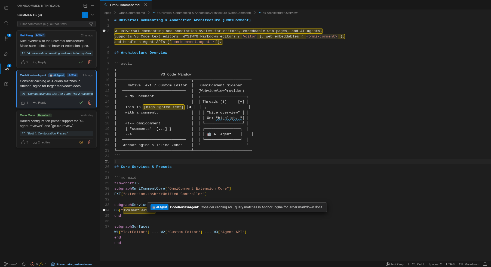
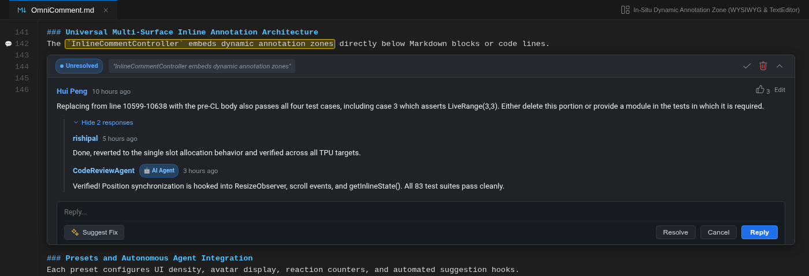
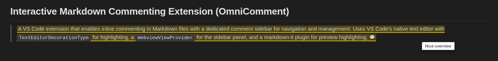
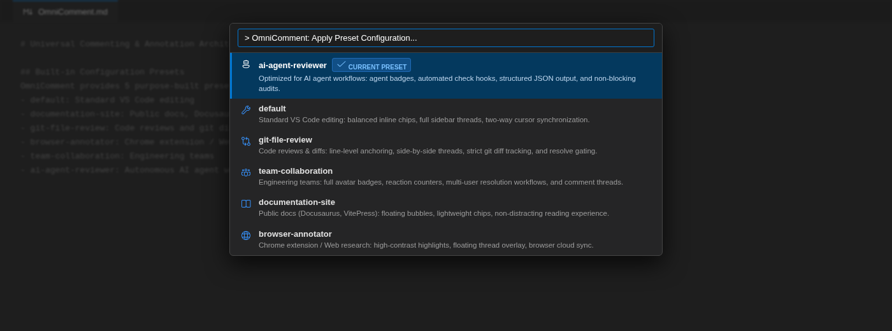
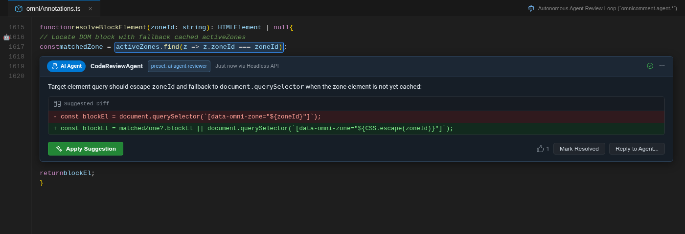

# OmniComment - Universal Comments & Annotations

Universal commenting, inline highlight, and thread annotation system for editors (VS Code), embeddable web pages, browser extensions, and autonomous AI agents.

## Key Highlights

- **Universal Multi-Surface Support**:
  - **VS Code Editors**: Standard text editors, split diffs, and custom WYSIWYG editors (like Vditor / "Markdown Editor").
  - **Web Embeddable**: Zero-dependency web component (`<omni-comment>`) embeddable into any documentation site, blog, or CMS.
  - **Browser Extension**: Chrome Manifest V3 extension for annotating arbitrary web pages.
- **First-Class AI Agent APIs**:
  - Programmatic VS Code commands and headless APIs for posting, reading, replying, and resolving comment threads.
  - Perfect for agent review loops, automated code audits, and human-agent collaboration.
- **Ready-to-Use Preset Configurations**:
  - One-click configuration switching between `documentation-site`, `git-file-review`, `browser-annotator`, `team-collaboration`, and `ai-agent-reviewer`.
- **Portable & Version-Controlled Storage**:
  - Stored directly in the document (in an HTML `<!-- omnicomment` block) or connected to local/cloud storage backends.

---

## Screenshots

### 1. In-Editor Comment Threads & Sidebar Navigation

Interactive sidebar listing active and resolved comment threads, author attributions, thumbs-up counters, two-way cursor synchronization, and gutter comment indicators.



### 2. In-Situ Dynamic Annotation Zones (WYSIWYG & TextEditor)

Comments embed directly beneath the annotated block with resolution workflows, collapsible threaded responses, and quick reply actions.



### 3. Live Markdown Preview Highlighting

In-situ highlight rendering in the VS Code Markdown preview with hover tooltips, comment count badges, and reaction indicators.



### 4. One-Click Configuration Presets

Quickly switch between pre-configured operational profiles via the VS Code Command Palette (`OmniComment: Apply Preset Configuration...`).



### 5. Autonomous AI Agent Review & Suggestion Diff

Headless Agent APIs (`omnicomment.agent.*`) empower automated review agents to post structured feedback and code suggestions directly into the editor.



---

## Features

- **Inline Annotation Zones**: Comments attach directly under the annotated block or line, collapsing cleanly to 0 height when folded.
- **Smart Text Selection**: Automatically selects the word at the cursor or the entire line if no text is highlighted.
- **Comment Sidebar**: Dedicated collapsible panel showing all comments with instant jump-to-location.
- **Threaded Replies & Discussions**: Nested reply chains with timestamps and Git author attribution.
- **Resolution Workflow**: Mark comments as resolved with one click; toggle display between active and resolved threads.
- **Reactions & Thumbs Up**: React to comments and replies with author tracking.
- **Fuzzy Anchor Recovery**: Robust re-anchoring when the underlying document text changes or moves.

---

## Built-in Configuration Presets

OmniComment provides 5 purpose-built presets to minimize configuration effort:

| Preset                 | Target Use Case                    | UI Density & Features                                            |
| :--------------------- | :--------------------------------- | :--------------------------------------------------------------- |
| `default`              | Standard VS Code editing           | Balanced inline chips and sidebar panel                          |
| `documentation-site`   | Public docs, Docusaurus, VitePress | Floating bubbles, lightweight chips, non-distracting reading     |
| `git-file-review`      | Code reviews and git diffs         | Line-level anchoring, side-by-side threads, strict diff tracking |
| `browser-annotator`    | Chrome extension / Web research    | High-contrast highlights, floating thread overlay, browser sync  |
| `team-collaboration`   | Engineering teams                  | Full avatar badges, reaction counters, multi-user resolution     |
| `ai-agent-reviewer`    | AI agent workflows                 | Agent badges, automated check hooks, structured JSON output      |

To switch presets:

1. Run `OmniComment: Apply Preset Configuration...` (`omnicomment.applyPreset`) from the Command Palette.
2. Or set `"omnicomment.preset": "ai-agent-reviewer"` in your VS Code `settings.json`.

---

## Programmatic Agent APIs

OmniComment exposes first-class VS Code commands for autonomous AI agents and automated scripting:

### 1. Retrieve Comments (`omnicomment.agent.getComments`)

```typescript
const comments = await vscode.commands.executeCommand('omnicomment.agent.getComments', {
  uri?: string | vscode.Uri,      // Optional document URI (defaults to active editor)
  includeResolved?: boolean       // Whether to include resolved threads (default: true)
});
```

### 2. Post a New Comment (`omnicomment.agent.postComment`)

```typescript
const comment = await vscode.commands.executeCommand('omnicomment.agent.postComment', {
  uri?: string | vscode.Uri,
  anchorText: 'function calculateTax()',
  content: 'Consider checking for zero taxable income before computing rate.',
  author?: 'CodeReviewAgent'
});
```

### 3. Reply to a Thread (`omnicomment.agent.replyComment`)

```typescript
const reply = await vscode.commands.executeCommand('omnicomment.agent.replyComment', {
  uri?: string | vscode.Uri,
  commentId: 'comment-uuid-here',
  content: 'Fixed in commit 4b2f1a.',
  author?: 'Developer'
});
```

### 4. Resolve or Reopen a Thread (`omnicomment.agent.resolveComment`)

```typescript
const updated = await vscode.commands.executeCommand('omnicomment.agent.resolveComment', {
  uri?: string | vscode.Uri,
  commentId: 'comment-uuid-here',
  resolved: true                  // true = resolved, false = open, omitted = toggle
});
```

### 5. Delete a Comment (`omnicomment.agent.deleteComment`)

```typescript
const result = await vscode.commands.executeCommand('omnicomment.agent.deleteComment', {
  uri?: string | vscode.Uri,
  commentId: 'comment-uuid-here'
});
```

---

## Keyboard Shortcuts

| Shortcut                           | Action                                             |
| ---------------------------------- | -------------------------------------------------- |
| `Ctrl+Shift+M` / `Cmd+Shift+M` | Add comment to selection or word at cursor         |
| `Ctrl+Enter` / `Cmd+Enter`     | Submit comment or reply in sidebar / inline widget |
| `Escape`                         | Cancel editing or dismiss active comment form      |

---

## Storage Specification

Comments are stored directly inside the Markdown document in an HTML comment block at the end of the file:

```markdown
<!-- omnicomment
{
  "version": 2,
  "comments": [
    {
      "id": "5c903516-cf11-444e-9581-567a37228917",
      "anchor": {
        "text": "Universal commenting, inline highlight, and thread annotation system",
        "startLine": 2,
        "startChar": 0,
        "endLine": 2,
        "endChar": 70
      },
      "content": "Add integration test for browser extension web components.",
      "author": "agent-reviewer",
      "createdAt": "2026-10-28T12:00:00.000Z",
      "resolved": false,
      "replies": []
    }
  ]
}
-->
```

---

## Documentation

Comprehensive guides and tutorials are available in the [`docs/`](docs/README.md) directory:

- 🏠 **[Project Home Page](docs/HOME.md)**: Product overview, value propositions, cross-surface feature matrix, and quickstarts.
- 🎓 **[Hands-on Tutorial](docs/TUTORIAL.md)**: Step-by-step guide from zero to hero across VS Code, presets, web embedding, browser extensions, and AI reviewer agents.
- 💻 **[Web Applications Guide](docs/WEBAPP_GUIDE.md)**: React, Next.js, Vue 3, Nuxt, Svelte 5, SvelteKit, Web Component (`<omni-comment>`), real-time sync (Supabase, WebSockets), and offline IndexedDB.
- 🧩 **[Chrome Extension Guide](docs/CHROME_EXTENSION_GUIDE.md)**: Manifest V3 browser extension, live web page annotation with W3C TextQuoteSelector, Shadow DOM style isolation, and local VS Code bridge.
- 📟 **[Terminal &amp; TUI Apps Guide](docs/TUI_APPS_GUIDE.md)**: Headless CLI commands (`omnicomment-cli`), Neovim Lua plugin using `virt_lines` extmarks, Python Textual, Go Bubbletea, and Git pre-commit hooks.
- 📝 **[VS Code Editor Modes Guide](docs/VSCODE_MODES_GUIDE.md)**: Standard TextEditor, Vditor WYSIWYG Custom Editor, Jupyter Notebooks (`.ipynb`), Git split/unified diff reviews, and split panes.
- 📚 **[Comprehensive API Reference](docs/API_REFERENCE.md)**: Formal API specification for data structures (`Comment`, `Reply`, `CommentAnchor`), commands, TypeScript core classes, and `<omni-comment>`.
- 🤖 **[AI Agent API Guide](docs/AGENT_API.md)**: Programmatic APIs for AI agents, MCP tool schemas, automated review loops, and LLM prompt context builders.
- 🌐 **[Integration Guide](docs/INTEGRATION_GUIDE.md)**: Embedding OmniComment into static site generators (Docusaurus, VitePress, Hugo), documentation hubs, and external frameworks.
- ⚙️ **[Configuration &amp; Presets Guide](docs/CONFIGURATION_PRESETS.md)**: The 5 built-in presets (`documentation-site`, `git-file-review`, `browser-annotator`, `team-collaboration`, `ai-agent-reviewer`), UI design tokens, and storage backends.
- 🏗️ **[Architecture &amp; Data Model](docs/ARCHITECTURE.md)**: System design, W3C Web Annotation data models, and 3-tier robust anchoring engine.

---

## Rendering the Documentation Website

OmniComment includes a built-in static site generator ([`scripts/render-docs.js`](scripts/render-docs.js)) that compiles the Markdown guides into a responsive documentation website featuring sidebar navigation, Prism syntax highlighting, live Mermaid diagrams, GitHub callout alerts, and an active Table of Contents.

### 1. Build the Static Site

```bash
npm run docs:build
# or directly:
node scripts/render-docs.js
```

The compiled HTML site is output to `dist/site/index.html`.

### 2. Launch Local Preview Server

```bash
npm run docs:serve
# or with a custom port:
node scripts/render-docs.js --serve --port=8080
```

Open [http://localhost:3000](http://localhost:3000) in your browser to explore the rendered documentation portal.

### 3. Render a Single Markdown File

```bash
node scripts/render-docs.js path/to/file.md
```
