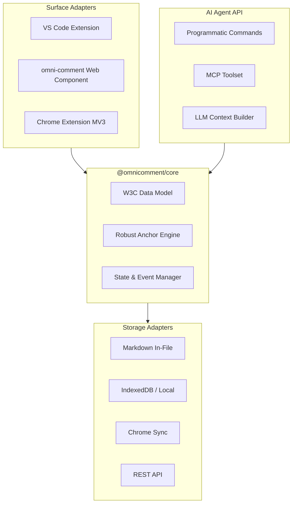
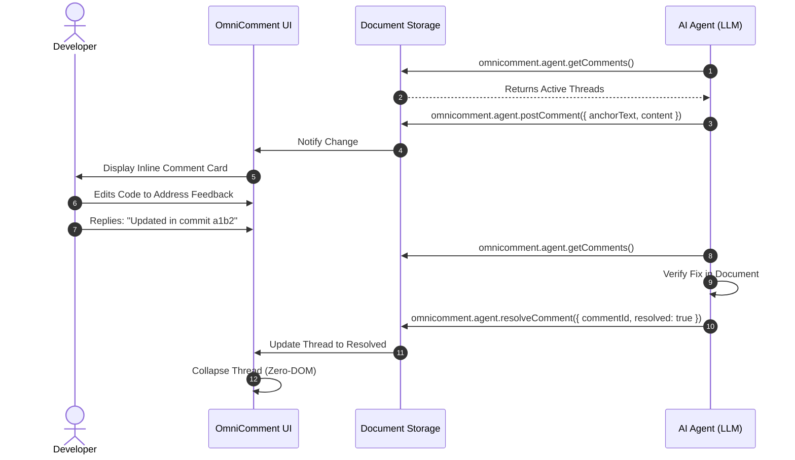

# OmniComment Architecture & Data Model

This document outlines the architectural principles, data schemas, modular package layout, and anchoring algorithms that power **OmniComment**.

---

## Table of Contents

1. [Architectural Principles](#1-architectural-principles)
2. [Monorepo Package Structure](#2-monorepo-package-structure)
3. [Data Model &amp; W3C Web Annotation Compliance](#3-data-model--w3c-web-annotation-compliance)
4. [3-Tier Robust Anchoring Engine](#4-3-tier-robust-anchoring-engine)
5. [Inline Zone &amp; Zero-DOM Layout Engine](#5-inline-zone--zero-dom-layout-engine)
6. [Component &amp; Sequence Diagrams](#6-component--sequence-diagrams)

---

## 1. Architectural Principles

1. **Surface Independence**: Core comment logic, thread resolution, and anchor tracking are strictly decoupled from VS Code or browser DOM APIs.
2. **Zero-Configuration Defaults**: Works out of the box with zero setup using standard presets, but supports deep customization.
3. **Lossless Portability**: Comment data lives either directly in the document (Git version-controlled) or in user-selected storage (Local, Sync, REST).
4. **AI-Agent First**: First-class programmatic commands, MCP tool definitions, and structured LLM prompt context builders.
5. **Robust Anchoring**: Annotations survive formatting edits, newline insertions, and markdown rendering variations.

---

## 2. Monorepo Package Structure

```
OmniComment/
├── packages/
│   ├── @omnicomment/core               # Data models, W3C parser, AnchorEngine
│   ├── @omnicomment/ui                 # Web Components, CSS tokens, thread cards
│   ├── @omnicomment/agent-api          # MCP tools, Agent commands, LLM serialization
│   ├── @omnicomment/storage-markdown   # In-file Markdown comment storage adapter
│   ├── @omnicomment/storage-browser    # LocalStorage / IndexedDB adapter
│   ├── @omnicomment/storage-chrome     # Chrome Storage Sync adapter
│   ├── @omnicomment/web-plugin         # Embeddable script & <omni-comment>
│   └── @omnicomment/browser-extension  # Manifest V3 Chrome Extension
└── extensions/
    └── vscode/                         # VS Code extension packaging
```

---

## 3. Data Model & W3C Web Annotation Compliance

OmniComment adopts the **W3C Web Annotation Data Model** (WD-annotation-model) while maintaining 100% backward compatibility with existing document blocks:

### Comment Entity Schema

```typescript
export interface Comment {
  /** Unique UUID v4 identifier */
  id: string;

  /** Anchor target describing where the comment attaches */
  anchor: CommentAnchor;

  /** Comment body in Markdown format */
  content: string;

  /** Author username or agent identifier */
  author: string;

  /** ISO 8601 creation timestamp */
  createdAt: string;

  /** ISO 8601 last update timestamp */
  updatedAt?: string;

  /** Thread resolution state */
  resolved?: boolean;

  /** Threaded replies */
  replies?: Reply[];

  /** List of usernames who reacted with thumbs up */
  thumbsUp?: string[];

  /** True if anchor text was deleted and needs re-anchoring */
  orphaned?: boolean;

  /** W3C Web Annotation selector metadata */
  w3cSelector?: {
    type: 'TextQuoteSelector';
    exact: string;
    prefix?: string;
    suffix?: string;
  };
}

export interface CommentAnchor {
  text: string;
  startLine: number;
  startChar: number;
  endLine: number;
  endChar: number;
}

export interface Reply {
  id: string;
  content: string;
  author: string;
  createdAt: string;
  updatedAt?: string;
  thumbsUp?: string[];
}
```

---

## 4. 3-Tier Robust Anchoring Engine

Documents constantly change as authors type, reformat, and delete text. OmniComment uses a 3-tier matching engine to ensure comments never detach unexpectedly:

```
                  +----------------------------------+
                  |  Target Anchor String to Locate  |
                  +----------------------------------+
                                   |
                                   v
             [Tier 1: Exact Line & Char Range Match]
                                   |
                        (Found?) --+--> Return Range
                                   | No
                                   v
        [Tier 2: Character-Preserving Normalized Markdown Map]
       - Strips zero-width spaces (\u200B, \u00A0)
       - Handles bold/italic/code delimiters (**, *, `, ~~)
       - Preserves character offsets back to source text
                                   |
                        (Found?) --+--> Return Mapped Range
                                   | No
                                   v
              [Tier 3: Fuzzy Levenshtein & Context Window]
       - Uses W3C prefix / suffix text context
       - Locates best substring match (similarity >= 0.85)
                                   |
                        (Found?) --+--> Return Best Range
                                   | No
                                   v
                       [Mark Comment as Orphaned]
                     (User prompted to re-anchor)
```

---

## 5. Inline Zone & Zero-DOM Layout Engine

To provide a native-feeling experience in both standard text editors and custom WYSIWYG editors:

1. **Inline Card Attachment**: Comments render directly underneath the paragraph or block element they annotate.
2. **Zero-DOM Collapsed State**:
   - When a user collapses an inline thread, the thread card returns `''` (no elements rendered).
   - If all comments on a block are collapsed, the container zone element is omitted completely.
   - The block's `margin-bottom` resets to `0px`.
   - Text snaps back up instantly with zero blank gaps or layout shifts.
3. **Isolated Styling**: When rendered inside web pages or browser extensions, the UI is wrapped in a `ShadowRoot` to prevent host CSS collisions.

---

## 6. Component & Sequence Diagrams

### Component Architecture



### Agent Comment & Resolution Sequence



<!-- omnicomment
{
  "version": 2,
  "comments": [
    {
      "id": "f274f1a3-5cf9-4481-b23f-b38cadc92d8e",
      "anchor": {
        "text": "Component Architecture",
        "startLine": 165,
        "startChar": 4,
        "endLine": 165,
        "endChar": 26
      },
      "content": "this diagram could not be rendered either, please fix it",
      "author": "Hui Peng",
      "createdAt": "2026-10-29T07:17:11.019Z",
      "resolved": true,
      "updatedAt": "2026-10-29T07:22:00.000Z",
      "replies": [
        {
          "id": "reply-fix-component-diagram",
          "content": "Fixed! Removed unescaped `<omni-comment>` HTML tag from the node label, resolving the Mermaid syntax error.",
          "author": "Jetski",
          "createdAt": "2026-10-29T07:22:00.000Z"
        }
      ]
    }
  ]
}
-->
