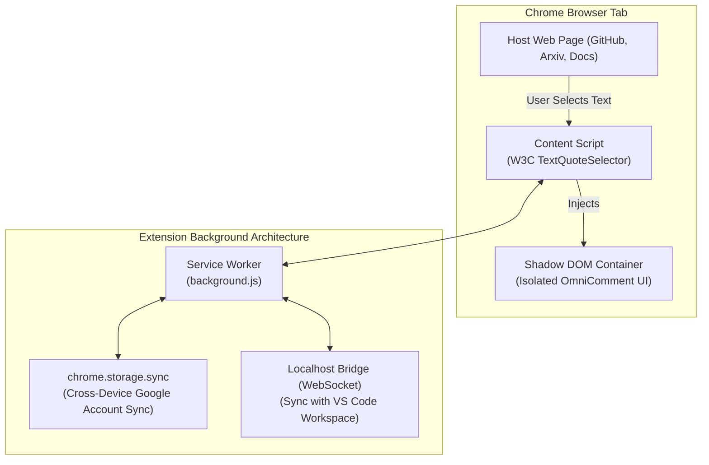

# OmniComment Chrome Extension Guide (Manifest V3)

Learn how to build, install, configure, and use the **OmniComment Chrome Extension** to highlight, annotate, discuss, and review any webpage across the internet.

---

## Table of Contents
1. [Overview & Value Proposition](#1-overview--value-proposition)
2. [Architecture (Manifest V3)](#2-architecture-manifest-v3)
3. [Developer Setup & Installation](#3-developer-setup--installation)
4. [User Workflow & Key Features](#4-user-workflow--key-features)
   - [Adding Comments via Selection Chip](#adding-comments-via-selection-chip)
   - [Keyboard Shortcuts & Context Menus](#keyboard-shortcuts--context-menus)
   - [Threaded Discussions & Resolution](#threaded-discussions--resolution)
5. [Resilient Web Anchoring (W3C TextQuoteSelector)](#5-resilient-web-anchoring-w3c-textquoteselector)
6. [Shadow DOM Style Isolation](#6-shadow-dom-style-isolation)
7. [Cross-Device Synchronization (`chrome.storage.sync`)](#7-cross-device-synchronization-chromestoragesync)
8. [Connecting with VS Code & Git Workspaces](#8-connecting-with-vs-code--git-workspaces)
9. [Exporting & Deep Linking](#9-exporting--deep-linking)

---

## 1. Overview & Value Proposition

The OmniComment Chrome Extension brings the collaborative commenting features of VS Code into the browser. It allows engineers, researchers, and technical writers to:
- Annotate API docs, RFC specifications, research papers, and technical blogs.
- Leave review notes directly on GitHub diffs, documentation previews, or staging sites.
- Export all comments in 100% Git-compatible format (`<!-- omnicomment ... -->`) to check into source code.



---

## 2. Architecture (Manifest V3)

The extension is structured according to Chrome's modern Manifest V3 specifications:

```
browser-extension/
├── manifest.json              # Extension metadata and permissions
├── icons/                     # Extension branding icons (16, 48, 128px)
├── src/
│   ├── background/
│   │   └── serviceWorker.ts   # Handles badge counts, tab updates, storage sync
│   ├── content/
│   │   ├── contentScript.ts   # Selection listener, anchor detection, DOM injection
│   │   ├── shadowRoot.ts      # Creates isolated Shadow DOM mount
│   │   └── annotator.css      # CSS injected solely inside the shadow root
│   ├── popup/
│   │   ├── popup.html         # Toolbar popup listing active domain annotations
│   │   └── popup.ts           # Filtering, export to markdown, settings
│   └── options/
│       ├── options.html       # Storage backend settings (Local, Supabase, Cloud)
│       └── options.ts
```

### Complete `manifest.json` Specification:
```json
{
  "manifest_version": 3,
  "name": "OmniComment - Universal Web Annotator",
  "version": "0.1.0",
  "description": "Universal commenting, inline highlight, and thread annotation system for any web page.",
  "icons": {
    "16": "icons/icon16.png",
    "48": "icons/icon48.png",
    "128": "icons/icon128.png"
  },
  "permissions": [
    "storage",
    "activeTab",
    "contextMenus"
  ],
  "host_permissions": [
    "<all_urls>"
  ],
  "action": {
    "default_popup": "popup/popup.html",
    "default_title": "OmniComment Annotations"
  },
  "background": {
    "service_worker": "dist/background/serviceWorker.js"
  },
  "content_scripts": [
    {
      "matches": ["<all_urls>"],
      "js": ["dist/content/contentScript.js"],
      "run_at": "document_idle"
    }
  ],
  "commands": {
    "add-comment": {
      "suggested_key": {
        "default": "Alt+Shift+C",
        "mac": "MacCtrl+Shift+C"
      },
      "description": "Add OmniComment on active text selection"
    },
    "toggle-sidebar": {
      "suggested_key": {
        "default": "Alt+Shift+O",
        "mac": "MacCtrl+Shift+O"
      },
      "description": "Toggle OmniComment side panel"
    }
  }
}
```

---

## 3. Developer Setup & Installation

### Step 1: Build the Extension
From the repository root or `browser-extension/` directory:
```bash
cd browser-extension
npm install
npm run build
```
This generates the bundled output inside `browser-extension/dist/`.

### Step 2: Load Unpacked in Chrome
1. Open Google Chrome and navigate to `chrome://extensions/`.
2. Enable **Developer mode** toggle in the top-right corner.
3. Click **Load unpacked** in the top-left corner.
4. Select the `browser-extension/` directory (or its `dist/` build directory).
5. The **OmniComment** icon will now appear in your browser toolbar!

---

## 4. User Workflow & Key Features

### Adding Comments via Selection Chip
1. Navigate to any website (e.g. `https://developer.mozilla.org` or your internal docs).
2. Highlight any sentence or paragraph with your mouse.
3. A floating **💬 Comment** chip immediately appears above your cursor.
4. Click the chip to expand the inline thread composer.
5. Type your note or question and press **Submit** (`Ctrl+Enter` / `Cmd+Enter`).
6. The text is now permanently highlighted with a glowing amber highlight, visible to you whenever you revisit that page!

### Keyboard Shortcuts & Context Menus
- **Shortcut**: Select text and press `Alt+Shift+C` (or `Cmd+Shift+C` on macOS) to open the comment box instantly without mouse movement.
- **Context Menu**: Right-click any highlighted text and choose **"Add OmniComment..."**.

### Threaded Discussions & Resolution
- **Replies**: Anyone collaborating on the page can reply to existing comments.
- **Resolving**: Click the **Resolve** (`✓`) button on a thread to fade out the highlight while preserving it in historical records.
- **Reopen**: Toggle resolved comments via the extension popup to view previously resolved threads.

---

## 5. Resilient Web Anchoring (W3C TextQuoteSelector)

Static web pages change. Advertisements load, responsive layouts reflow, and DOM trees shift. OmniComment uses the **W3C Web Annotation Data Model** `TextQuoteSelector` to ensure that highlights never get orphaned.

```json
{
  "type": "TextQuoteSelector",
  "exact": "OmniComment enables universal commenting",
  "prefix": "In this technical specification, ",
  "suffix": " across all major developer surfaces."
}
```

### Self-Healing Anchor Algorithm:
```typescript
export function findWebAnchor(selector: TextQuoteSelector, rootNode: Node = document.body): Range | null {
  const textContent = rootNode.textContent || '';
  
  // Tier 1: Exact search with Prefix + Exact + Suffix
  const fullPattern = selector.prefix + selector.exact + selector.suffix;
  const fullIndex = textContent.indexOf(fullPattern);
  if (fullIndex !== -1) {
    return createRangeFromOffsets(rootNode, fullIndex + selector.prefix.length, selector.exact.length);
  }

  // Tier 2: Search exact string alone
  const exactIndex = textContent.indexOf(selector.exact);
  if (exactIndex !== -1) {
    return createRangeFromOffsets(rootNode, exactIndex, selector.exact.length);
  }

  // Tier 3: Trigram / Levenshtein fuzzy match across whitespace changes
  return recoverFuzzyAnchor(rootNode, selector.exact);
}
```

---

## 6. Shadow DOM Style Isolation

Webpages use aggressive CSS frameworks (Tailwind resets, Bootstrap, high-specificity rules). To ensure OmniComment UI renders pristinely without affecting or being affected by the host website, all UI widgets are mounted inside an **isolated ShadowRoot**:

```typescript
// contentScript.ts
export function createIsolatedContainer(): { container: HTMLElement; shadow: ShadowRoot } {
  let host = document.getElementById('omnicomment-extension-host');
  if (!host) {
    host = document.createElement('div');
    host.id = 'omnicomment-extension-host';
    document.documentElement.appendChild(host);
  }

  const shadow = host.attachShadow({ mode: 'open' });

  // Inject scoped stylesheet directly into shadow root
  const styleEl = document.createElement('style');
  styleEl.textContent = `
    :host {
      all: initial;
      font-family: -apple-system, BlinkMacSystemFont, "Segoe UI", Roboto, sans-serif;
      z-index: 2147483647;
    }
    .omni-chip {
      position: absolute;
      background: #1f2328;
      color: #e6edf3;
      border: 1px solid rgba(255, 190, 0, 0.75);
      border-radius: 999px;
      padding: 4px 10px;
      font-size: 12px;
      box-shadow: 0 4px 14px rgba(0, 0, 0, 0.3);
      cursor: pointer;
    }
  `;
  shadow.appendChild(styleEl);

  const container = document.createElement('div');
  container.className = 'omni-extension-container';
  shadow.appendChild(container);

  return { container, shadow };
}
```

---

## 7. Cross-Device Synchronization (`chrome.storage.sync`)

By default, comments created via the extension are saved to `chrome.storage.sync`. When you sign in to Google Chrome on another workstation, all your notes and annotations automatically synchronize:

```typescript
// Save annotation on current domain
export async function saveAnnotation(url: string, comment: OmniCommentData): Promise<void> {
  const domainKey = `omni_${new URL(url).hostname}`;
  const existing = (await chrome.storage.sync.get(domainKey))[domainKey] || [];
  existing.push(comment);
  await chrome.storage.sync.set({ [domainKey]: existing });
}

// Retrieve annotations for active tab
export async function loadAnnotations(url: string): Promise<OmniCommentData[]> {
  const domainKey = `omni_${new URL(url).hostname}`;
  const data = await chrome.storage.sync.get(domainKey);
  return data[domainKey] || [];
}
```

---

## 8. Connecting with VS Code & Git Workspaces

You can bridge the Chrome Extension with your local VS Code workspace:

1. Enable the **Localhost Bridge** in the OmniComment Extension Options (`http://localhost:31338`).
2. When viewing local documentation files or PR preview servers (`localhost:3000`), comments posted in the browser are sent directly via WebSocket to VS Code.
3. The VS Code extension receives the payload and writes it directly into the Markdown file's `<!-- omnicomment` block!
4. Commit your changes with `git commit`: your browser notes are now permanently tracked in version control!

---

## 9. Exporting & Deep Linking

### Exporting Comments
Click the OmniComment icon in the Chrome toolbar to open the popup:
- **Copy as Markdown Block**: Copies a formatted `<!-- omnicomment ... -->` JSON block ready to paste into any documentation file.
- **Export Summary**: Copies a bulleted Markdown list of all highlights, author notes, and replies.

### Deep Linking to Specific Highlights
Share direct links with teammates that automatically scroll to and open a specific annotation:
```
https://docs.mycompany.com/architecture#omnicomment:7b92f1a4
```
When a teammate opens this URL with the extension installed, OmniComment highlights the anchor and opens the comment thread automatically.
