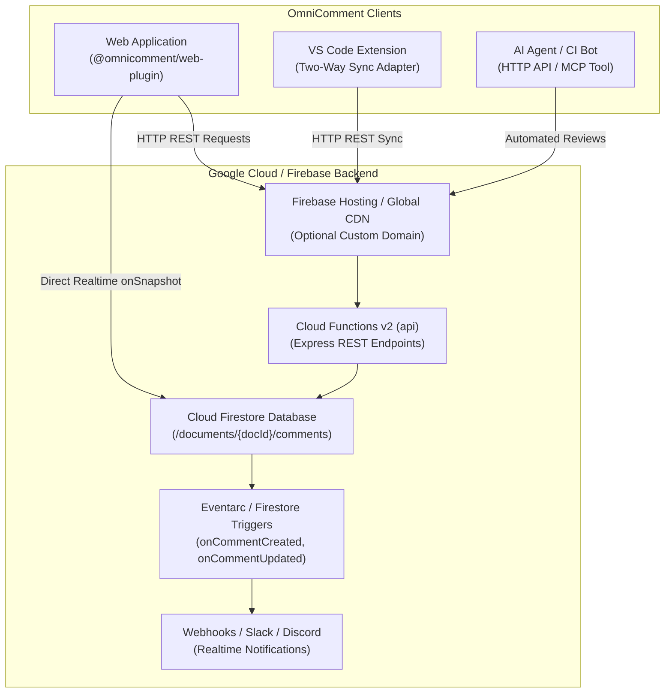
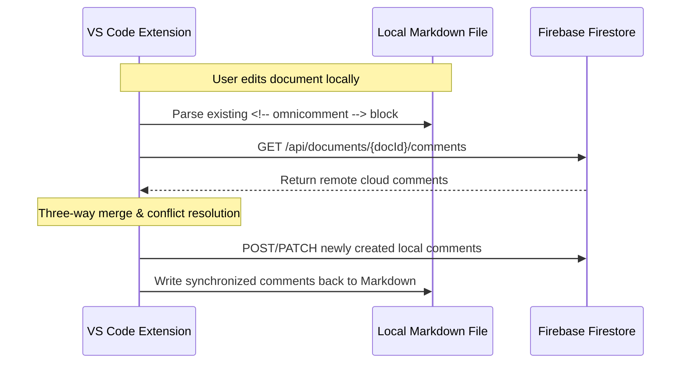

# OmniComment Firebase Persistence Server Guide

Comprehensive operational guide for deploying, configuring, and maintaining a high-performance, real-time comment persistence backend for **OmniComment** using **Firebase Cloud Functions (v2)** and **Google Cloud Firestore**.

---

## Table of Contents

1. [Architecture & Data Model](#1-architecture--data-model)
2. [Prerequisites & Initial Setup](#2-prerequisites--initial-setup)
3. [Local Development & Firebase Emulator Suite](#3-local-development--firebase-emulator-suite)
4. [Firestore Security Rules & Schema Validation](#4-firestore-security-rules--schema-validation)
5. [Production Deployment Step-by-Step](#5-production-deployment-step-by-step)
6. [Web App Client Integration](#6-web-app-client-integration)
   - [Method A: Real-Time Direct Firestore SDK](#method-a-real-time-direct-firestore-sdk)
   - [Method B: Serverless REST API Client](#method-b-serverless-rest-api-client)
7. [Two-Way Synchronization with VS Code Extension](#7-two-way-synchronization-with-vs-code-extension)
8. [Production Operations, Monitoring & Scaling](#8-production-operations-monitoring--scaling)

---

## 1. Architecture & Data Model

OmniComment's Firebase server provides a dual-access persistence layer:
1. **Direct Real-Time Firestore Synchronization**: Connects client web applications (React, Next.js, Vue, Svelte) directly to Cloud Firestore via `onSnapshot` listeners, delivering live comment updates and cursor indicators in under 100ms.
2. **Serverless REST API (Cloud Functions v2)**: Provides standard HTTP endpoints (`GET`, `POST`, `PATCH`, `DELETE`) for non-Firebase environments, CI/CD bots, AI review agents, and corporate intranets.



### Firestore Document Hierarchy

All comments are stored in scoped subcollections under target document IDs:

```text
/databases/(default)/documents/
  └── documents/
        └── {documentId}/
              └── comments/
                    └── {commentId}/
                          ├── id: string
                          ├── documentId: string
                          ├── anchor: map
                          │     ├── text: string
                          │     ├── startLine: int
                          │     ├── startChar: int
                          │     ├── endLine: int
                          │     └── endChar: int
                          ├── selector: map (optional W3C TextQuoteSelector)
                          ├── content: string
                          ├── author: string
                          ├── authorId: string (optional auth UID)
                          ├── createdAt: string (ISO 8601)
                          ├── updatedAt: string (ISO 8601)
                          ├── resolved: boolean
                          ├── orphaned: boolean
                          ├── thumbsUp: array of string
                          └── replies: array of map
                                └── [ { id, content, author, createdAt } ]
```

> [!TIP]
> Storing thread replies inside an embedded `replies` array allows fetching a complete comment thread and all its replies in a single atomic Firestore read operation, eliminating unnecessary network round-trips.

---

## 2. Prerequisites & Initial Setup

### Required Tools
- **Node.js**: Version 18.x or 20.x LTS.
- **Firebase CLI**: Global installation via npm:
  ```bash
  npm install -g firebase-tools
  ```
- **Google Cloud / Firebase Account**: A project registered on the [Firebase Console](https://console.firebase.google.com).
- **Blaze Plan (Pay-as-you-go)**: Cloud Functions v2 and external network requests require the project to be upgraded to the Blaze billing plan (which includes a generous free tier of 2M function invocations and 50k Firestore reads/day).

### Project Configuration
1. Log in to your Firebase account:
   ```bash
   firebase login
   ```
2. Navigate to the server folder:
   ```bash
   cd servers/firebase
   ```
3. Associate your Firebase project:
   ```bash
   firebase use --add
   ```
   Select your desired project alias (e.g., `production` or `staging`).

4. Install server dependencies:
   ```bash
   npm install
   ```

---

## 3. Local Development & Firebase Emulator Suite

The Firebase Local Emulator Suite enables you to build, test, and debug your functions and Firestore security rules locally without incurring cloud costs or modifying production data.

### 1. Start the Emulators
```bash
npm run serve
```

This compiles TypeScript in watch mode and spins up the following local services:
- **Cloud Functions**: `http://127.0.0.1:5001/<your-project-id>/us-central1/api`
- **Cloud Firestore**: `http://127.0.0.1:8080`
- **Authentication**: `http://127.0.0.1:9099`
- **Emulator UI Dashboard**: `http://127.0.0.1:4000`

Open `http://localhost:4000` in your browser to inspect collections, create mock users, and monitor function logs in real time.

---

### 2. Testing Endpoints Locally with `curl`

#### Health Check
```bash
curl -X GET http://127.0.0.1:5001/<your-project-id>/us-central1/api/health
```
**Response:**
```json
{
  "status": "ok",
  "service": "omnicomment-firebase-server",
  "timestamp": "2026-10-29T10:30:00.000Z"
}
```

#### Create a New Comment Thread
```bash
curl -X POST http://127.0.0.1:5001/<your-project-id>/us-central1/api/documents/doc-guide-01/comments \
  -H "Content-Type: application/json" \
  -d '{
    "content": "Please verify if this calculation accounts for leap seconds.",
    "author": "Dr. Emmett Brown",
    "anchor": {
      "text": "const secondsInYear = 31536000;",
      "startLine": 42,
      "startChar": 2,
      "endLine": 42,
      "endChar": 34
    }
  }'
```

#### Fetch All Comments for a Document
```bash
curl -X GET "http://127.0.0.1:5001/<your-project-id>/us-central1/api/documents/doc-guide-01/comments?includeResolved=true"
```

#### Add a Reply to an Existing Thread
```bash
curl -X POST http://127.0.0.1:5001/<your-project-id>/us-central1/api/documents/doc-guide-01/comments/<comment-id>/replies \
  -H "Content-Type: application/json" \
  -d '{
    "author": "Marty McFly",
    "content": "Good catch! Fixed in commit 8d2f1b."
  }'
```

#### Resolve a Comment Thread
```bash
curl -X PATCH http://127.0.0.1:5001/<your-project-id>/us-central1/api/documents/doc-guide-01/comments/<comment-id> \
  -H "Content-Type: application/json" \
  -d '{
    "resolved": true
  }'
```

#### Delete a Comment Thread
```bash
curl -X DELETE http://127.0.0.1:5001/<your-project-id>/us-central1/api/documents/doc-guide-01/comments/<comment-id>
```

---

## 4. Firestore Security Rules & Schema Validation

Security is enforced at the database layer using `firestore.rules`. This prevents malicious clients from bypassing application logic or corrupting text anchors.

### Security Rules Highlights (`firestore.rules`)
```javascript
rules_version = '2';

service cloud.firestore {
  match /databases/{database}/documents {

    function isAuthenticated() {
      return request.auth != null;
    }

    function isValidAnchor(anchor) {
      return anchor is map
        && anchor.keys().hasAll(['text', 'startLine', 'startChar', 'endLine', 'endChar'])
        && anchor.text is string
        && anchor.startLine is int
        && anchor.startChar is int
        && anchor.endLine is int
        && anchor.endChar is int;
    }

    function isValidCommentCreate() {
      let data = request.resource.data;
      return data.keys().hasAll(['id', 'content', 'author', 'createdAt', 'anchor'])
        && data.id is string
        && data.content is string
        && data.content.size() > 0
        && data.content.size() <= 10000
        && data.author is string
        && data.createdAt is string
        && isValidAnchor(data.anchor);
    }

    function isValidCommentUpdate() {
      let incoming = request.resource.data;
      let existing = resource.data;
      // Invariant: Core immutable fields cannot be altered post-creation
      return incoming.id == existing.id
        && incoming.createdAt == existing.createdAt
        && incoming.anchor == existing.anchor
        && incoming.author == existing.author;
    }

    match /documents/{documentId}/comments/{commentId} {
      allow read: if true;
      allow create: if isValidCommentCreate();
      allow update: if isValidCommentUpdate();
      allow delete: if isAuthenticated();
    }
  }
}
```

### Deploying Security Rules Separately
When tweaking security rules or indexes without modifying function code:
```bash
npm run deploy:rules
npm run deploy:indexes
```

---

## 5. Production Deployment Step-by-Step

Follow these steps to deploy to Google Cloud production infrastructure:

### Step 1: Build the TypeScript Code
```bash
npm run build
```
Verify that the `dist/` directory contains compiled JavaScript and type definitions.

### Step 2: Configure Environment Variables & Secrets
If your server integrates with Slack, Discord, or GitHub tokens, store them securely in Google Secret Manager:
```bash
firebase functions:secrets:set SLACK_WEBHOOK_URL
```

### Step 3: Run Full Production Deployment
```bash
npm run deploy
```

The Firebase CLI outputs your live Cloud Function REST API URL:
```text
✔  Deploy complete!

Function URL (api): https://us-central1-<project-id>.cloudfunctions.net/api
```

### Step 4: (Optional) Map Custom Domain with Firebase Hosting
To serve your comments API under your primary domain (e.g. `https://docs.mycompany.com/api/comments`), add a rewrite rule in `firebase.json`:

```json
{
  "hosting": {
    "public": "public",
    "rewrites": [
      {
        "source": "/api/**",
        "function": "api"
      }
    ]
  }
}
```

---

## 6. Web App Client Integration

### Method A: Real-Time Direct Firestore SDK

The recommended approach for responsive web applications. Uses Firestore `onSnapshot` for instant multi-user synchronization.

#### 1. Install Dependencies
```bash
npm install --save firebase @omnicomment/web-plugin
```

#### 2. Initialize Firebase and Mount OmniComment
```typescript
import { initializeApp } from 'firebase/app';
import { getFirestore, collection, query, orderBy, onSnapshot, doc, setDoc, deleteDoc } from 'firebase/firestore';
import { initOmniComment } from '@omnicomment/web-plugin';
import '@omnicomment/web-plugin/dist/omnicomment.css';

// 1. Firebase Client Configuration
const firebaseConfig = {
  apiKey: "AIzaSyD-YourApiKey",
  authDomain: "my-project.firebaseapp.com",
  projectId: "my-project",
  storageBucket: "my-project.appspot.com",
  messagingSenderId: "1234567890",
  appId: "1:1234567890:web:abcdef"
};

const app = initializeApp(firebaseConfig);
const db = getFirestore(app);

// 2. Custom Real-Time Storage Adapter
const firestoreStorage = {
  type: 'custom',
  subscribe: (documentId: string, onUpdate: (comments: any[]) => void) => {
    const commentsRef = collection(db, 'documents', documentId, 'comments');
    const q = query(commentsRef, orderBy('createdAt', 'asc'));
    return onSnapshot(q, (snapshot) => {
      const comments = snapshot.docs.map(doc => doc.data());
      onUpdate(comments);
    });
  },
  saveComment: async (documentId: string, comment: any) => {
    const docRef = doc(db, 'documents', documentId, 'comments', comment.id);
    await setDoc(docRef, comment, { merge: true });
  },
  deleteComment: async (documentId: string, commentId: string) => {
    const docRef = doc(db, 'documents', documentId, 'comments', commentId);
    await deleteDoc(docRef);
  }
};

// 3. Mount OmniComment on Document Article
const omni = initOmniComment({
  target: '#article-content',
  documentId: 'api-reference-v2',
  author: 'Ada Lovelace',
  preset: 'team-collaboration',
  storage: firestoreStorage
});
```

---

### Method B: Serverless REST API Client

Use this method when your application cannot bundle the Firebase client SDK or needs to communicate via a standard REST API.

```typescript
import { initOmniComment } from '@omnicomment/web-plugin';

const omni = initOmniComment({
  target: '#article-content',
  documentId: 'api-reference-v2',
  author: 'Ada Lovelace',
  preset: 'team-collaboration',
  storage: {
    type: 'rest',
    endpoint: 'https://us-central1-my-project.cloudfunctions.net/api/api/documents/api-reference-v2/comments',
    headers: {
      'Content-Type': 'application/json'
    }
  }
});
```

---

## 7. Two-Way Synchronization with VS Code Extension

OmniComment allows bi-directional synchronization between local in-file comments (`<!-- omnicomment ... -->`) and the remote Firebase Firestore database.



### Sync Script Example (`scripts/sync-firebase.ts`)
```typescript
import * as fs from 'fs';
import { MarkdownStorageAdapter } from '@omnicomment/core';
import { FirebaseRestClient } from '../servers/firebase/src/client';

async function syncLocalWithCloud(filePath: string, docId: string, endpoint: string) {
  const client = new FirebaseRestClient({ endpoint });
  const adapter = new MarkdownStorageAdapter();

  const fileContent = fs.readFileSync(filePath, 'utf-8');
  const localComments = adapter.parseComments(fileContent);
  const remoteComments = await client.getComments(docId);

  // Merge remote comments into local collection
  const mergedMap = new Map();
  for (const c of localComments) mergedMap.set(c.id, c);
  for (const c of remoteComments) mergedMap.set(c.id, c);

  const finalComments = Array.from(mergedMap.values());
  const updatedFile = adapter.serializeComments(fileContent, finalComments);
  fs.writeFileSync(filePath, updatedFile, 'utf-8');

  console.log(`Synchronized ${finalComments.length} comments between ${filePath} and Firebase.`);
}
```

---

## 8. Production Operations, Monitoring & Scaling

### 1. Streaming Live Server Logs
To follow live execution logs and inspect request latencies:
```bash
firebase functions:log --only api
```

### 2. Cold-Start Mitigation
To ensure instantaneous API response times for critical documentation portals, configure minimum instances in `src/index.ts`:

```typescript
export const api = onRequest(
  {
    cors: true,
    region: 'us-central1',
    minInstances: 1, // Eliminates cold starts by keeping 1 warm container
    maxInstances: 20
  },
  app
);
```

### 3. Automated Firestore Database Backups
Schedule daily automated backups using Google Cloud Storage:
```bash
# Create Cloud Storage bucket for backups
gcloud storage buckets create gs://omnicomment-firestore-backups --location=us-central1

# Schedule daily export job via Google Cloud Scheduler
gcloud scheduler jobs create http firestore-daily-backup \
  --schedule="0 2 * * *" \
  --uri="https://firestore.googleapis.com/v1/projects/my-project/databases/(default):exportDocuments" \
  --http-method=POST \
  --message-body='{"outputUriPrefix":"gs://omnicomment-firestore-backups"}' \
  --oauth-service-account-email="firebase-adminsdk@my-project.iam.gserviceaccount.com"
```

### 4. Firestore Cost Optimization Tips
- **Batch Updates**: Use `FieldValue.arrayUnion()` to append replies rather than creating subdocuments.
- **Client Cache**: Enable offline persistence in the Web SDK using `enableIndexedDbPersistence(firestore)` to serve repeated reads directly from browser IndexedDB.
- **Selective Sync**: Query only unresolved comments (`where('resolved', '==', false)`) on mobile readers to conserve mobile bandwidth.
