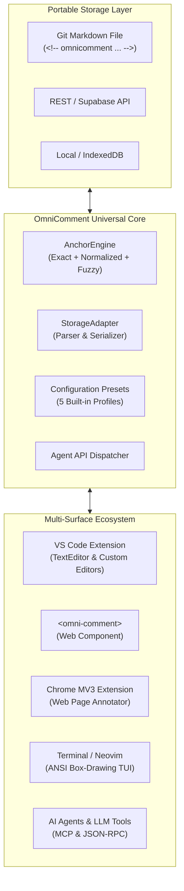

# OmniComment

<div align="center">


### Universal In-Context Comments, Highlights, and Collaboration for Humans & AI

[](https://github.com/benquike/OmniComment)
[](file:///usr/local/google/home/phui/src/tools/editor/Markco/LICENSE)
[](file:///usr/local/google/home/phui/src/tools/editor/Markco/src/test/)
[](https://marketplace.visualstudio.com/)
[](file:///usr/local/google/home/phui/src/tools/editor/Markco/docs/INTEGRATION_GUIDE.md)
[](file:///usr/local/google/home/phui/src/tools/editor/Markco/docs/AGENT_API.md)

[**Getting Started Tutorial**](file:///usr/local/google/home/phui/src/tools/editor/Markco/docs/TUTORIAL.md) · [**Full API Reference**](file:///usr/local/google/home/phui/src/tools/editor/Markco/docs/API_REFERENCE.md) · [**Integration Guide**](file:///usr/local/google/home/phui/src/tools/editor/Markco/docs/INTEGRATION_GUIDE.md) · [**Architecture**](file:///usr/local/google/home/phui/src/tools/editor/Markco/docs/ARCHITECTURE.md) · [**Presets**](file:///usr/local/google/home/phui/src/tools/editor/Markco/docs/CONFIGURATION_PRESETS.md)

</div>

---

## What is OmniComment?

**OmniComment** is a universal annotation, threaded discussion, and collaborative review system that works everywhere you read and write:

1. **In Your Code Editor**: Rich inline comment bubbles and collapsible thread zones right next to your Markdown, code, and documentation in **VS Code**.
2. **On the Web**: A zero-dependency `<omni-comment>` custom web component that embeds interactive commenting into Docusaurus, VitePress, Next.js, Hugo, or raw HTML in one line of code.
3. **Across the Browser**: A Chrome Manifest V3 extension for capturing highlights, personal notes, and team feedback on any live website or web app.
4. **Inside the Terminal**: An ANSI terminal renderer that formats comment threads into box-drawing inspection cards for CLI pipelines and Neovim users.
5. **For Autonomous AI Agents**: Structured, programmatic API commands (`omnicomment.agent.*`) that let LLMs, code-review bots, and automated agents inspect document context, post targeted feedback, and resolve threads.

> [!TIP]
> **Zero Vendor Lock-In**: Comments can be stored directly within your Markdown files using human-readable, Git-versioned comments (`<!-- omnicomment ... -->`), in local files, or synced to cloud endpoints.

---

## Why OmniComment?

Traditional commenting systems are fragmented. GitHub and GitLab PR comments are trapped in proprietary databases and vanish once a branch is merged. Google Docs comments don't live in your Git repository. Web highlight extensions don't sync with your local editor.

OmniComment bridges this divide:



### The 4 Pillars of OmniComment

| Pillar | How OmniComment Solves It |
| :--- | :--- |
| **1. Multi-Surface Ubiquity** | Run the exact same commenting logic across desktop editors (VS Code), static documentation sites, Chrome browser tabs, and headless CLI pipelines. |
| **2. Lossless Portability** | Store comments directly in the document body as a standard HTML comment block. Comments travel with your files, branch with Git, and endure across editor migrations. |
| **3. Self-Healing 3-Tier Anchoring** | When underlying text moves or edits occur, the `AnchorEngine` automatically recovers positions using (1) Exact Substring matching, (2) Normalized Markdown stripping, and (3) Trigram/Levenshtein fuzzy recovery. |
| **4. First-Class AI Collaboration** | Built from the ground up for human-agent symbiosis. Agents inspect comment contexts via JSON, post precise line annotations, and resolve issues autonomously. |

---

## Ecosystem Feature Matrix

| Feature | VS Code Extension | Web `<omni-comment>` | Chrome MV3 Extension | Terminal TUI | AI Agent API |
| :--- | :---: | :---: | :---: | :---: | :---: |
| **Inline Highlight Decoration** | ✅ | ✅ | ✅ | ✅ (ANSI color) | — |
| **Threaded Multi-turn Discussions** | ✅ | ✅ | ✅ | ✅ (Cards) | ✅ |
| **Emoji Reactions & Thumbs Up** | ✅ | ✅ | ✅ | ✅ | ✅ |
| **Resolution / Reopening Workflow** | ✅ | ✅ | ✅ | ✅ | ✅ |
| **Collapsible Zero-DOM Folding** | ✅ | ✅ | ✅ | — | — |
| **Preset Configuration Switching** | ✅ | ✅ | ✅ | ✅ | ✅ |
| **Direct Git Markdown In-File Storage** | ✅ | Optional | Optional | ✅ | ✅ |
| **Headless JSON Programmatic Access** | ✅ | ✅ | ✅ | ✅ | ✅ |

---

## 3-Minute Quickstart

### 1. In VS Code
1. Install `omnicomment-0.1.0.vsix` via Extensions view (`Extensions: Install from VSIX...`).
2. Open any `.md` or `.skill` file.
3. Highlight any phrase and press `Cmd+Shift+M` (macOS) or `Ctrl+Shift+M` (Windows/Linux).
4. Type your comment and press **Enter** (or `Ctrl+Enter`). An inline discussion bubble appears immediately!

### 2. On a Web Page or Documentation Site
Embed interactive commenting on any web page in two lines:

```html
<!-- Load the zero-dependency web component -->
<script type="module" src="https://unpkg.com/@omnicomment/web-plugin/dist/index.js"></script>

<!-- Attach comments to your documentation article -->
<omni-comment preset="documentation-site" target="#article-body"></omni-comment>
```

### 3. For AI Agents & Scripts
Programmatically query or post comments from an AI assistant or CI check:

```typescript
import * as vscode from 'vscode';

// 1. Post automated review feedback
await vscode.commands.executeCommand('omnicomment.agent.postComment', {
  anchorText: 'const total = calculateSum(items);',
  content: 'Warning: `items` can be empty, causing an unhandled NaN in sum.',
  author: 'GeminiReviewer'
});

// 2. Fetch all unresolved comments
const unresolved = await vscode.commands.executeCommand('omnicomment.agent.getComments', {
  includeResolved: false
});
```

---

## Built-In Configuration Presets

OmniComment provides 5 purpose-built presets to instantly tailor UI density, storage mode, and review behavior:

````carousel
```json
// Preset: "documentation-site"
{
  "preset": "documentation-site",
  "storageMode": "localStorage",
  "uiDensity": "minimal",
  "highlightColor": "rgba(59, 130, 246, 0.25)",
  "features": { "reactions": true, "authorAvatars": false }
}
```
<!-- slide -->
```json
// Preset: "git-file-review"
{
  "preset": "git-file-review",
  "storageMode": "in-file",
  "uiDensity": "compact",
  "highlightColor": "rgba(245, 158, 11, 0.3)",
  "features": { "diffLineAnchoring": true, "strictTracking": true }
}
```
<!-- slide -->
```json
// Preset: "ai-agent-reviewer"
{
  "preset": "ai-agent-reviewer",
  "storageMode": "in-file",
  "uiDensity": "compact",
  "highlightColor": "rgba(99, 102, 241, 0.35)",
  "features": { "agentBadges": true, "jsonRpcExport": true }
}
```
<!-- slide -->
```json
// Preset: "team-collaboration"
{
  "preset": "team-collaboration",
  "storageMode": "rest-api",
  "uiDensity": "comfortable",
  "highlightColor": "rgba(139, 92, 246, 0.3)",
  "features": { "authorAvatars": true, "emailAlerts": true }
}
```
````

Switch presets anytime in VS Code via `OmniComment: Apply Preset Configuration...` (`omnicomment.applyPreset`).

---

## Next Steps

- **Follow the [Step-by-Step Tutorial](file:///usr/local/google/home/phui/src/tools/editor/Markco/docs/TUTORIAL.md)** for detailed guides across VS Code, Web, TUI, and AI agent automation.
- **Consult the [Comprehensive API Reference](file:///usr/local/google/home/phui/src/tools/editor/Markco/docs/API_REFERENCE.md)** for data models, function signatures, and event hooks.
- **Learn how to embed on websites in the [Integration Guide](file:///usr/local/google/home/phui/src/tools/editor/Markco/docs/INTEGRATION_GUIDE.md)** (Docusaurus, VitePress, Hugo, Chrome extensions).
- **Inspect the technical design in the [Architecture Specification](file:///usr/local/google/home/phui/src/tools/editor/Markco/docs/ARCHITECTURE.md)**.
