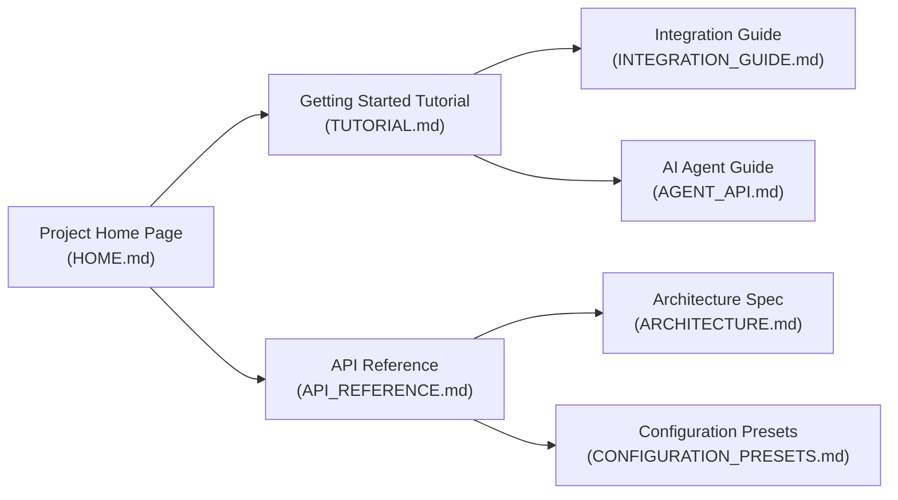

# OmniComment Documentation Portal

Welcome to the **OmniComment** documentation portal. OmniComment is a universal in-context commenting, inline annotation, and collaborative discussion platform designed for editors (VS Code), embeddable web documentation, browser extensions, terminals, and autonomous AI agents.

---

## Documentation Navigation



---

## Complete Guide Index

| Document | Purpose & Description | Target Audience |
| :--- | :--- | :--- |
| **[Project Home Page](file:///usr/local/google/home/phui/src/tools/editor/Markco/docs/HOME.md)** | High-impact overview, feature matrices, architecture diagram, and quickstarts. Ideal template for a project landing page or website root. | Everyone, Evaluators, Site Visitors |
| **[Hands-on Tutorial](file:///usr/local/google/home/phui/src/tools/editor/Markco/docs/TUTORIAL.md)** | Complete step-by-step tutorial from zero to hero: VS Code workflows, presets, web embedding (`<omni-comment>`), browser extensions, and AI reviewer agents. | Developers, Content Writers, AI Engineers |
| **[Comprehensive API Reference](file:///usr/local/google/home/phui/src/tools/editor/Markco/docs/API_REFERENCE.md)** | Complete formal specification of data structures (`Comment`, `Reply`, `CommentAnchor`), VS Code commands, `AnchorEngine`, storage adapters, and web component attributes. | API Integrators, Plugin Authors |
| **[AI Agent API Guide](file:///usr/local/google/home/phui/src/tools/editor/Markco/docs/AGENT_API.md)** | Dedicated programmatic API manual for LLMs and autonomous agents, including MCP tool definitions and automated review loops. | AI Agent Developers, LLM Tool Builders |
| **[Integration Guide](file:///usr/local/google/home/phui/src/tools/editor/Markco/docs/INTEGRATION_GUIDE.md)** | Instructions for integrating OmniComment into static site generators (Docusaurus, VitePress, Hugo), Chrome extensions, and TUI/Neovim. | Frontend Engineers, Web Authors |
| **[Configuration & Presets](file:///usr/local/google/home/phui/src/tools/editor/Markco/docs/CONFIGURATION_PRESETS.md)** | Detailed specifications for the 5 built-in presets (`documentation-site`, `git-file-review`, `browser-annotator`, `team-collaboration`, `ai-agent-reviewer`). | End Users, System Administrators |
| **[Architecture & Data Model](file:///usr/local/google/home/phui/src/tools/editor/Markco/docs/ARCHITECTURE.md)** | Deep-dive architectural specification, monorepo package layout, 3-tier fuzzy anchoring mathematics, and storage block design. | Core Contributors, Architects |

---

## Quick Reference Snippets

### 1. Embed on Any Website
```html
<script type="module" src="https://unpkg.com/@omnicomment/web-plugin/dist/index.js"></script>
<omni-comment target="#content" preset="documentation-site"></omni-comment>
```

### 2. Programmatic AI Agent Call
```typescript
await vscode.commands.executeCommand('omnicomment.agent.postComment', {
  anchorText: 'const total = calculateSum(items);',
  content: 'Consider adding input validation for empty arrays.',
  author: 'GeminiCodeReviewer [AI]'
});
```

### 3. CLI Terminal Inspection
```bash
npx ts-node src/cli/tuiRenderer.ts docs/ARCHITECTURE.md --unresolved
```

### 4. Build & Preview the Documentation Website
```bash
npm run docs:build   # Compiles all markdown files into dist/site/
npm run docs:serve   # Starts local preview web server at http://localhost:3000
```
