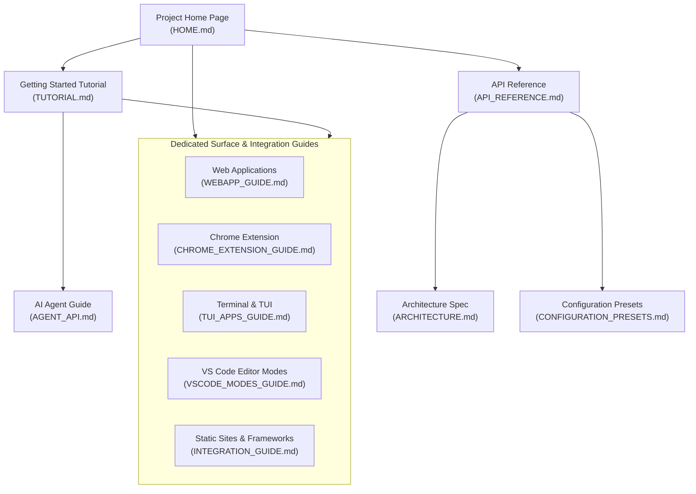

# OmniComment Documentation Portal

Welcome to the **OmniComment** documentation portal. OmniComment is a universal in-context commenting, inline annotation, and collaborative discussion platform designed for editors (VS Code), embeddable web documentation, browser extensions, terminals, and autonomous AI agents.

---

## Documentation Navigation



---

## Complete Guide Index

| Document | Purpose & Description | Target Audience |
| :--- | :--- | :--- |
| **[Project Home Page](HOME.md)** | High-impact overview, feature matrices, architecture diagram, and quickstarts. Ideal template for a project landing page or website root. | Everyone, Evaluators, Site Visitors |
| **[Hands-on Tutorial](TUTORIAL.md)** | Complete step-by-step tutorial from zero to hero: VS Code workflows, presets, web embedding (`<omni-comment>`), browser extensions, and AI reviewer agents. | Developers, Content Writers, AI Engineers |
| **[Web Applications Guide](WEBAPP_GUIDE.md)** | Comprehensive integration guide for React, Next.js, Vue 3, Nuxt, Svelte 5, SvelteKit, `<omni-comment>` Web Component, WebSockets/Supabase real-time sync, and IndexedDB offline cache. | Frontend & Fullstack Engineers |
| **[Chrome Extension Guide](CHROME_EXTENSION_GUIDE.md)** | Deep dive into Chrome Manifest V3 extension, live DOM text highlight injection, W3C `TextQuoteSelector`, Shadow DOM CSS isolation, and local VS Code bridge. | Browser Extension Developers, Researchers |
| **[Terminal & TUI Apps Guide](TUI_APPS_GUIDE.md)** | Guide to terminal workflows: headless CLI (`omnicomment-cli`), Neovim Lua plugin using `virt_lines` extmarks, Python Textual app, Go Bubbletea UI, and Git pre-commit hooks. | Terminal Enthusiasts, Neovim Users, DevOps |
| **[VS Code Editor Modes Guide](VSCODE_MODES_GUIDE.md)** | Guide across all VS Code surfaces: Standard TextEditor, Vditor WYSIWYG Custom Editor, Jupyter Notebooks (`.ipynb`), Git split/unified diff reviews, and split panes. | VS Code Power Users & Extension Devs |
| **[Comprehensive API Reference](API_REFERENCE.md)** | Complete formal specification of data structures (`Comment`, `Reply`, `CommentAnchor`), VS Code commands, `AnchorEngine`, storage adapters, and web component attributes. | API Integrators, Plugin Authors |
| **[AI Agent API Guide](AGENT_API.md)** | Dedicated programmatic API manual for LLMs and autonomous agents, including MCP tool definitions and automated review loops. | AI Agent Developers, LLM Tool Builders |
| **[Integration Guide](INTEGRATION_GUIDE.md)** | Instructions for integrating OmniComment into static site generators (Docusaurus, VitePress, Hugo), documentation hubs, and external frameworks. | Web Authors, Technical Writers |
| **[Configuration & Presets](CONFIGURATION_PRESETS.md)** | Detailed specifications for the 5 built-in presets (`documentation-site`, `git-file-review`, `browser-annotator`, `team-collaboration`, `ai-agent-reviewer`). | End Users, System Administrators |
| **[Architecture & Data Model](ARCHITECTURE.md)** | Deep-dive architectural specification, monorepo package layout, 3-tier fuzzy anchoring mathematics, and storage block design. | Core Contributors, Architects |

---

## Quick Reference Snippets

### 1. Embed on Any Website
```html
<script type="module" src="https://unpkg.com/@omnicomment/web-plugin/dist/index.js"></script>
<omni-comment target="#content" preset="documentation-site"></omni-comment>
```

### 2. Programmatic AI Agent Call
```typescript
await vscode.commands.executeCommand('omnicomment.agent.postComment', {
  anchorText: 'const total = calculateSum(items);',
  content: 'Consider adding input validation for empty arrays.',
  author: 'GeminiCodeReviewer [AI]'
});
```

### 3. CLI Terminal Inspection
```bash
npx ts-node src/cli/tuiRenderer.ts docs/ARCHITECTURE.md --unresolved
```

### 4. Build & Preview the Documentation Website
```bash
npm run docs:build   # Compiles all markdown files into dist/site/
npm run docs:serve   # Starts local preview web server at http://localhost:3000
```
