# OmniComment Server Frameworks & Backend Integration Guide

Comprehensive guide for implementing, deploying, and maintaining **OmniComment** comment persistence backends across modern server-side languages and web frameworks, including **Python (FastAPI & Flask)**, **Go (Gin & net/http)**, **PHP (Modern PHP 8 & Laravel)**, **Angular SSR (Express & Node.js)**, **Node.js (Express)**, and **Java (Spring Boot)**.

---

## Table of Contents

1. [Architecture & Unified REST API Contract](#1-architecture--unified-rest-api-contract)
2. [Data Model & Coordinate Schema](#2-data-model--coordinate-schema)
3. [Python Backend Implementations](#3-python-backend-implementations)
   - [FastAPI (Asynchronous & Pydantic v2)](#fastapi-asynchronous--pydantic-v2)
   - [Flask (Lightweight WSGI)](#flask-lightweight-wsgi)
4. [Go (Golang) Backend Implementations](#4-go-golang-backend-implementations)
   - [Gin Framework (High Concurrency & File/DB Store)](#gin-framework-high-concurrency--filedb-store)
   - [Standard Library net/http (Zero Dependencies)](#standard-library-nethttp-zero-dependencies)
5. [PHP Backend Implementations](#5-php-backend-implementations)
   - [Modern Standalone PHP 8.2+ (PDO SQLite)](#modern-standalone-php-82-pdo-sqlite)
   - [Laravel 10 & 11 (Eloquent & Route Controller)](#laravel-10--11-eloquent--route-controller)
6. [Angular SSR & Express Application Server](#6-angular-ssr--express-application-server)
7. [Other Frameworks (Node.js Express & Java Spring Boot)](#7-other-frameworks-nodejs-express--java-spring-boot)
8. [Client Integration with @omnicomment/web-plugin](#8-client-integration-with-omnicommentweb-plugin)
9. [Security, Authentication & Production Hardening](#9-security-authentication--production-hardening)

---

## 1. Architecture & Unified REST API Contract

The OmniComment client SDK (`@omnicomment/web-plugin`) communicates with backends through a standard REST interface. Any web server implementing these 6 HTTP routes can seamlessly persist, update, and resolve comment threads.

```mermaid
flowchart LR
    subgraph Client ["Browser / Editor Client"]
        SDK["@omnicomment/web-plugin\n(REST Storage Adapter)"]
    end

    subgraph BackendGateway ["Web Framework / Gateway"]
        ROUTER["HTTP Router\n(/api/documents/:docId/comments)"]
        AUTH["Auth Middleware\n(Bearer JWT / Session)"]
        ROUTER --> AUTH
    end

    subgraph ServerFrameworks ["Supported Server Backends"]
        PY["Python\n(FastAPI / Flask)"]
        GO["Go\n(Gin / net/http)"]
        PHP["PHP\n(PHP 8.2+ / Laravel)"]
        ANGULAR["Angular SSR\n(server.ts / Express)"]
        NODE["Node.js\n(Express / NestJS)"]
    end

    subgraph StorageEngine ["Database & Storage"]
        SQLITE["SQLite"]
        PG["PostgreSQL / MySQL"]
        JSONSTORE["JSON File Store"]
    end

    SDK -->|REST HTTP Requests| ROUTER
    AUTH --> PY
    AUTH --> GO
    AUTH --> PHP
    AUTH --> ANGULAR
    AUTH --> NODE
    PY --> SQLITE
    GO --> JSONSTORE
    PHP --> SQLITE
    ANGULAR --> JSONSTORE
    NODE --> PG
```



### Standard REST Endpoints

| Method | URI Pattern | Description |
| :--- | :--- | :--- |
| `GET` | `/health` | Server health check and uptime probe |
| `GET` | `/api/documents/:docId/comments` | Retrieve all comments for a document (supports `?includeResolved=bool&sort=asc\|desc`) |
| `GET` | `/api/documents/:docId/comments/:commentId` | Retrieve a single comment thread |
| `POST` | `/api/documents/:docId/comments` | Create a new comment thread anchored to document text |
| `PATCH` | `/api/documents/:docId/comments/:commentId` | Update comment content, toggle `resolved`, or add reactions |
| `POST` | `/api/documents/:docId/comments/:commentId/replies` | Append a reply to an existing comment thread |
| `DELETE` | `/api/documents/:docId/comments/:commentId` | Delete a comment thread (cascades to all replies) |

---

## 2. Data Model & Coordinate Schema

### 1. `CommentAnchor`
Specifies the highlighted text and position in the document:
```json
{
  "text": "const total = a + b;",
  "startLine": 12,
  "startChar": 2,
  "endLine": 12,
  "endChar": 22
}
```

### 2. `CommentReply`
Discussion messages within a thread:
```json
{
  "id": "reply-a1b2c3d4",
  "content": "Addressed in commit 8d2f1b.",
  "author": "Alice",
  "createdAt": "2026-10-29T10:00:00Z",
  "updatedAt": "2026-10-29T10:00:00Z",
  "thumbsUp": ["user-123"]
}
```

### 3. `OmniComment`
Complete thread record:
```json
{
  "id": "comment-9f8e7d6c",
  "documentId": "getting-started",
  "anchor": {
    "text": "const total = a + b;",
    "startLine": 12,
    "startChar": 2,
    "endLine": 12,
    "endChar": 22
  },
  "content": "Should we handle potential integer overflow here?",
  "author": "Dr. Emmett Brown",
  "createdAt": "2026-10-29T09:30:00Z",
  "updatedAt": "2026-10-29T10:00:00Z",
  "resolved": false,
  "orphaned": false,
  "thumbsUp": ["user-456"],
  "replies": []
}
```

---

## 3. Python Backend Implementations

Ready-to-run source code is located in [`servers/python-fastapi/`](../servers/python-fastapi/).

### FastAPI (Asynchronous & Pydantic v2)

FastAPI provides automatic OpenAPI schema generation, fast asynchronous SQLite/PostgreSQL operations, and Pydantic v2 data validation with automatic camelCase transformation.

#### Quickstart:
```bash
cd servers/python-fastapi
python3 -m venv .venv && source .venv/bin/activate
pip install -r requirements.txt
uvicorn main:app --reload --port 8000
```

#### Key Architecture Highlights:
```python
# servers/python-fastapi/main.py
from fastapi import FastAPI, HTTPException, Query
from pydantic import BaseModel, ConfigDict
from pydantic.alias_generators import to_camel
import aiosqlite

class CamelModel(BaseModel):
    """Ensures JSON payload matches browser camelCase properties."""
    model_config = ConfigDict(alias_generator=to_camel, populate_by_name=True)

class CommentAnchor(CamelModel):
    text: str
    start_line: int
    start_char: int
    end_line: int
    end_char: int

@app.post("/api/documents/{doc_id}/comments", status_code=201)
async def create_comment(doc_id: str, payload: CreateCommentDto):
    comment_id = payload.id or f"comment-{uuid.uuid4().hex[:12]}"
    now = datetime.now(timezone.utc).isoformat()
    # Save to SQLite asynchronously...
    return {"success": True, "comment": new_comment}
```

---

### Flask (Lightweight WSGI)

For Flask applications using SQLAlchemy:

```python
# app.py
from flask import Flask, request, jsonify
from flask_sqlalchemy import SQLAlchemy
from datetime import datetime, timezone
import uuid

app = Flask(__name__)
app.config['SQLALCHEMY_DATABASE_URI'] = 'sqlite:///comments.db'
db = SQLAlchemy(app)

class CommentModel(db.Model):
    __tablename__ = 'comments'
    id = db.Column(db.String(64), primary_key=True)
    document_id = db.Column(db.String(128), index=True, nullable=False)
    anchor_json = db.Column(db.Text, nullable=False)
    content = db.Column(db.Text, nullable=False)
    author = db.Column(db.String(128), nullable=False)
    created_at = db.Column(db.String(64), nullable=False)
    updated_at = db.Column(db.String(64), nullable=False)
    resolved = db.Column(db.Boolean, default=False)

@app.route('/api/documents/<doc_id>/comments', methods=['GET'])
def list_comments(doc_id):
    include_resolved = request.args.get('includeResolved', 'true') != 'false'
    query = CommentModel.query.filter_by(document_id=doc_id)
    if not include_resolved:
        query = query.filter_by(resolved=False)
    comments = query.all()
    return jsonify({"success": True, "comments": [c.to_dict() for c in comments]})

@app.route('/api/documents/<doc_id>/comments', methods=['POST'])
def create_comment(doc_id):
    data = request.json
    now = datetime.now(timezone.utc).isoformat()
    cid = data.get('id') or f"comment-{uuid.uuid4().hex[:12]}"
    comment = CommentModel(
        id=cid,
        document_id=doc_id,
        anchor_json=json.dumps(data['anchor']),
        content=data['content'],
        author=data['author'],
        created_at=now,
        updated_at=now,
        resolved=False
    )
    db.session.add(comment)
    db.session.commit()
    return jsonify({"success": True, "comment": comment.to_dict()}), 201
```

---

## 4. Go (Golang) Backend Implementations

Ready-to-run source code is located in [`servers/go-gin/`](../servers/go-gin/).

### Gin Framework (High Concurrency & File/DB Store)

The Go Gin implementation provides sub-millisecond response times, concurrency-safe atomic reads/writes, zero CGO requirements, and statically links into a single compact binary (<15MB).

#### Quickstart:
```bash
cd servers/go-gin
go mod tidy
go run main.go
```

#### Key Architecture Highlights:
```go
// servers/go-gin/main.go
type CommentAnchor struct {
    Text      string `json:"text" binding:"required"`
    StartLine int    `json:"startLine"`
    StartChar int    `json:"startChar"`
    EndLine   int    `json:"endLine"`
    EndChar   int    `json:"endChar"`
}

type OmniComment struct {
    ID         string         `json:"id"`
    DocumentID string         `json:"documentId"`
    Anchor     CommentAnchor  `json:"anchor"`
    Content    string         `json:"content"`
    Author     string         `json:"author"`
    CreatedAt  string         `json:"createdAt"`
    UpdatedAt  string         `json:"updatedAt"`
    Resolved   bool           `json:"resolved"`
    Replies    []CommentReply `json:"replies"`
}

r.POST("/api/documents/:docId/comments", func(c *gin.Context) {
    docID := c.Param("docId")
    var dto CreateCommentDto
    if err := c.ShouldBindJSON(&dto); err != nil {
        c.JSON(http.StatusBadRequest, gin.H{"success": false, "error": err.Error()})
        return
    }
    // Concurrency-safe atomic insert...
})
```

---

### Standard Library net/http (Zero Dependencies)

If you prefer zero external dependencies, standard library `net/http` with Go 1.22+ path patterns handles routing cleanly:

```go
package main

import (
    "encoding/json"
    "net/http"
    "sync"
)

type Server struct {
    mu       sync.RWMutex
    comments map[string][]map[string]any
}

func (s *Server) handleListOrAdd(w http.ResponseWriter, r *http.Request) {
    docID := r.PathValue("docId")
    w.Header().Set("Content-Type", "application/json")
    w.Header().Set("Access-Control-Allow-Origin", "*")

    if r.Method == http.MethodGet {
        s.mu.RLock()
        list := s.comments[docID]
        s.mu.RUnlock()
        json.NewEncoder(w).Encode(map[string]any{"success": true, "comments": list})
        return
    }

    if r.Method == http.MethodPost {
        var payload map[string]any
        json.NewDecoder(r.Body).Decode(&payload)
        s.mu.Lock()
        s.comments[docID] = append(s.comments[docID], payload)
        s.mu.Unlock()
        w.WriteHeader(http.StatusCreated)
        json.NewEncoder(w).Encode(map[string]any{"success": true, "comment": payload})
        return
    }
}
```

---

## 5. PHP Backend Implementations

Ready-to-run source code is located in [`servers/php/`](../servers/php/).

### Modern Standalone PHP 8.2+ (PDO SQLite)

A clean, dependency-free PHP REST backend that automatically creates its SQLite database schema on startup and runs directly on PHP CLI or Nginx/Apache.

#### Quickstart:
```bash
cd servers/php
php -S 0.0.0.0:8000 -t public
```

#### Key Architecture Highlights:
```php
// servers/php/src/CommentController.php
namespace OmniComment;

class CommentController
{
    private \PDO $db;

    public function listComments(string $docId): void
    {
        $stmt = $this->db->prepare("SELECT * FROM comments WHERE document_id = :docId ORDER BY created_at ASC");
        $stmt->execute([':docId' => $docId]);
        $rows = $stmt->fetchAll();
        $this->json(['success' => true, 'comments' => $rows]);
    }

    public function createComment(string $docId, array $data): void
    {
        $stmt = $this->db->prepare("
            INSERT INTO comments (id, document_id, anchor_json, content, author, created_at, updated_at)
            VALUES (:id, :docId, :anchor, :content, :author, :now, :now)
        ");
        $stmt->execute([...]);
        $this->json(['success' => true], 201);
    }
}
```

---

### Laravel 10 & 11 (Eloquent & Route Controller)

Drop-in controller available at [`servers/php/laravel/OmniCommentController.php`](../servers/php/laravel/OmniCommentController.php).

#### 1. Route Registration (`routes/api.php`):
```php
use App\Http\Controllers\OmniCommentController;

Route::prefix('documents/{docId}/comments')->group(function () {
    Route::get('/', [OmniCommentController::class, 'index']);
    Route::post('/', [OmniCommentController::class, 'store']);
    Route::get('{commentId}', [OmniCommentController::class, 'show']);
    Route::patch('{commentId}', [OmniCommentController::class, 'update']);
    Route::delete('{commentId}', [OmniCommentController::class, 'destroy']);
    Route::post('{commentId}/replies', [OmniCommentController::class, 'storeReply']);
});
```

#### 2. Database Migration:
```php
Schema::create('comments', function (Blueprint $table) {
    $table->string('id')->primary();
    $table->string('document_id')->index();
    $table->json('anchor_json');
    $table->text('content');
    $table->string('author');
    $table->string('created_at');
    $table->string('updated_at');
    $table->boolean('resolved')->default(false);
    $table->boolean('orphaned')->default(false);
    $table->json('thumbs_up_json')->default('[]');
});
```

---

## 6. Angular SSR & Express Application Server

Ready-to-run source code is located in [`servers/angular-ssr/`](../servers/angular-ssr/).

Modern Angular applications (Angular 17, 18, and 19) leverage Angular SSR with a unified Node.js Express server (`server.ts`). This allows hosting both server-rendered Angular components and the OmniComment persistence REST API inside the same service, eliminating cross-origin CORS overhead and simplifying deployment.

### 1. Angular Express SSR Server (`server.ts`)
```typescript
import express, { Request, Response } from 'express';
import cors from 'cors';
import * as path from 'path';

const app = express();
const PORT = process.env['PORT'] || 4000;

app.use(cors({ origin: true }));
app.use(express.json());

// In-memory + persistent atomic storage
const store: Record<string, Record<string, any>> = {};

// GET: Retrieve comments for document
app.get('/api/documents/:docId/comments', (req: Request, res: Response) => {
  const { docId } = req.params;
  const includeResolved = req.query['includeResolved'] !== 'false';
  let list = Object.values(store[docId] || {});
  if (!includeResolved) list = list.filter((c) => !c.resolved);
  res.json({ success: true, count: list.length, comments: list });
});

// POST: Create comment thread
app.post('/api/documents/:docId/comments', (req: Request, res: Response) => {
  const { docId } = req.params;
  const comment = { id: `comment-${Date.now()}`, documentId: docId, ...req.body, createdAt: new Date().toISOString() };
  if (!store[docId]) store[docId] = {};
  store[docId][comment.id] = comment;
  res.status(201).json({ success: true, comment });
});

// Angular SSR Fallback (serves rendered HTML or Angular bootstrap)
app.get('*', (req: Request, res: Response) => {
  res.send('<!DOCTYPE html><html><body><app-root></app-root></body></html>');
});

app.listen(PORT, () => console.log(`Angular SSR & OmniComment API on http://localhost:${PORT}`));
```

### 2. Angular RxJS Client Service (`omni-comment.service.ts`)
```typescript
import { Injectable, inject } from '@angular/core';
import { HttpClient } from '@angular/common/http';
import { Observable, map } from 'rxjs';
import { OmniComment, CreateCommentDto } from '../models/omni-comment.model';

@Injectable({ providedIn: 'root' })
export class OmniCommentService {
  private http = inject(HttpClient);
  private baseUrl = '/api/documents';

  getComments(docId: string, includeResolved: boolean = true): Observable<OmniComment[]> {
    return this.http.get<{ comments: OmniComment[] }>(
      `${this.baseUrl}/${encodeURIComponent(docId)}/comments?includeResolved=${includeResolved}`
    ).pipe(map((res) => res.comments || []));
  }

  createComment(docId: string, dto: CreateCommentDto): Observable<OmniComment> {
    return this.http.post<{ comment: OmniComment }>(
      `${this.baseUrl}/${encodeURIComponent(docId)}/comments`,
      dto
    ).pipe(map((res) => res.comment));
  }
}
```

### 3. Quickstart & Local Run
```bash
cd servers/angular-ssr
npm install
npm run serve
```

---

## 7. Other Frameworks (Node.js Express & Java Spring Boot)

### Node.js Express

```javascript
const express = require('express');
const cors = require('cors');
const app = express();

app.use(cors());
app.use(express.json());

const db = new Map(); // Replace with Prisma / PostgreSQL

app.get('/api/documents/:docId/comments', (req, res) => {
  const comments = db.get(req.params.docId) || [];
  res.json({ success: true, count: comments.length, comments });
});

app.post('/api/documents/:docId/comments', (req, res) => {
  const list = db.get(req.params.docId) || [];
  const comment = { id: `comment-${Date.now()}`, ...req.body, createdAt: new Date().toISOString() };
  list.push(comment);
  db.set(req.params.docId, list);
  res.status(201).json({ success: true, comment });
});

app.listen(8000, () => console.log('Listening on :8000'));
```

---

### Java (Spring Boot Controller)

```java
@RestController
@RequestMapping("/api/documents/{docId}/comments")
@CrossOrigin(origins = "*")
public class OmniCommentController {

    @Autowired
    private CommentRepository repository;

    @GetMapping
    public ResponseEntity<ApiResponse<List<CommentDto>>> listComments(
            @PathVariable String docId,
            @RequestParam(defaultValue = "true") boolean includeResolved) {
        List<CommentDto> comments = repository.findByDocumentId(docId, includeResolved);
        return ResponseEntity.ok(new ApiResponse<>(true, comments));
    }

    @PostMapping
    public ResponseEntity<ApiResponse<CommentDto>> createComment(
            @PathVariable String docId,
            @Valid @RequestBody CreateCommentRequest request) {
        CommentDto created = repository.save(docId, request);
        return ResponseEntity.status(HttpStatus.CREATED).body(new ApiResponse<>(true, created));
    }
}
```

---

## 8. Client Integration with `@omnicomment/web-plugin`

Connecting `@omnicomment/web-plugin` to any of the above backends requires just specifying the REST storage configuration:

```typescript
import { initOmniComment } from '@omnicomment/web-plugin';
import '@omnicomment/web-plugin/dist/omnicomment.css';

const docId = 'api-guide-v2';

const omni = initOmniComment({
  target: '#article-content',
  documentId: docId,
  author: 'Ada Lovelace',
  preset: 'team-collaboration',
  storage: {
    type: 'rest',
    // Point to Python, Go, PHP, or Node.js server URL
    endpoint: `http://localhost:8000/api/documents/${encodeURIComponent(docId)}/comments`,
    headers: {
      'Content-Type': 'application/json',
      'Authorization': 'Bearer ' + userSessionToken
    }
  },
  onCommentAdded: (comment) => console.log('Comment created:', comment.id),
  onCommentResolved: (commentId) => console.log('Resolved thread:', commentId)
});
```

---

## 9. Security, Authentication & Production Hardening

### 1. JWT Authentication Middleware
Ensure only authenticated users can create or modify comments:

#### Python FastAPI:
```python
from fastapi import Depends, Header

async def verify_jwt(authorization: str = Header(...)):
    token = authorization.replace("Bearer ", "")
    # Validate token using PyJWT...
```

#### Go Gin:
```go
func authMiddleware() gin.HandlerFunc {
    return func(c *gin.Context) {
        token := c.GetHeader("Authorization")
        if token == "" {
            c.AbortWithStatusJSON(401, gin.H{"error": "Unauthorized"})
            return
        }
        c.Next()
    }
}
```

#### PHP:
```php
$headers = getallheaders();
$authHeader = $headers['Authorization'] ?? '';
if (!preg_match('/Bearer\s(\S+)/', $authHeader)) {
    http_response_code(401);
    exit;
}
```

### 2. Input Sanitization & Anchor Validation
- Always enforce character limits (e.g., maximum 10,000 characters for comment content).
- Ensure `startLine`, `startChar`, `endLine`, `endChar` are positive integers.
- Store highlighted text coordinates verbatim; browser clients escape HTML upon render.
