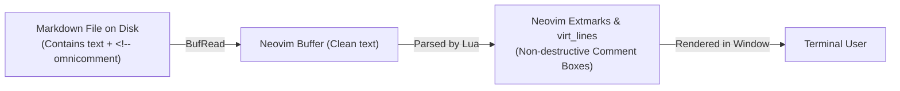

# OmniComment Terminal User Interface (TUI) & CLI Guide

A comprehensive guide on using **OmniComment** in terminal workflows, Neovim/Vim, command-line review pipelines, and custom TUI applications built with Python Textual, Go Bubbletea, and Rust Ratatui.

---

## Table of Contents
1. [Why OmniComment in the Terminal?](#1-why-omnicomment-in-the-terminal)
2. [OmniComment CLI Utility (`omnicomment-cli`)](#2-omnicomment-cli-utility-omnicomment-cli)
   - [Installation](#cli-installation)
   - [Viewing Commented Documents with ANSI Highlighting (`view`)](#viewing-commented-documents-with-ansi-highlighting)
   - [Listing & Filtering Comments (`list`)](#listing--filtering-comments)
   - [Adding Comments from CLI (`add`)](#adding-comments-from-cli)
   - [Resolving & Replying (`resolve` / `reply`)](#resolving--replying)
3. [Neovim Integration (`omnicomment.nvim`)](#3-neovim-integration-omnicommentnvim)
   - [Architecture (Extmarks & Virtual Lines)](#neovim-architecture)
   - [Complete Lua Plugin Code](#complete-lua-plugin-code)
   - [Keymaps & User Experience](#neovim-keymaps)
4. [Building Interactive TUI Apps](#4-building-interactive-tui-apps)
   - [Python Textual TUI Application](#python-textual-tui-application)
   - [Go Bubbletea Review Tool](#go-bubbletea-review-tool)
5. [Git Workflow & CI/CD Automation](#5-git-workflow--cicd-automation)
   - [Git Pager Integration (`git diff`)](#git-pager-integration)
   - [Pre-Commit Hook: Block on Unresolved Comments](#pre-commit-hook-block-on-unresolved-comments)
   - [CI/CD Pipeline Audit](#cicd-pipeline-audit)

---

## 1. Why OmniComment in the Terminal?

Because OmniComment stores comments directly inside Markdown files as human-readable HTML comments (`<!-- omnicomment\n{...}\n-->`), comments are 100% accessible to terminal tools without needing a web server or proprietary API.

The decoupled core engine (`AnchorEngine` and `MarkdownStorageAdapter`) provides:
- **Terminal TrueColor (24-bit) Highlighting**: Highlight annotated code and prose directly in terminal emulators.
- **Box-Drawing Unicode Comments**: Clean, beautifully rendered comment boxes integrated under lines.
- **Zero Dependencies**: Parse, modify, and resolve comments directly using standard Unix filters and CLI scripts.

```
14 │ function calculateTax(income: number): number {
15 │   const rate = 0.20;
   │     ┌─ 💬 UNRESOLVED  @CodeReviewAgent (1 hr ago) ──────────────────────────┐
   │     │  Consider checking for zero or negative taxable income values here.    │
   │     ├─ ▾ 1 Reply ───────────────────────────────────────────────────────────┤
   │     │  @HuiPeng: Good catch! Added input validation guard clause.            │
   │     └───────────────────────────────────────────────────────────────────────┘
16 │   return income * rate;
17 │ }
```

---

## 2. OmniComment CLI Utility (`omnicomment-cli`)

### CLI Installation
Install the global CLI via npm:
```bash
npm install -g @omnicomment/cli
# Or run directly via npx
npx @omnicomment/cli --help
```

---

### Viewing Commented Documents with ANSI Highlighting

Render any commented Markdown or source file with syntax highlighting, inline comment boxes, and ANSI color escapes:

```bash
omnicomment view spec/OmniComment.md
```

#### Flags:
- `--no-color`: Disable ANSI color escape codes (useful for piping into files).
- `--unresolved-only`: Hide resolved threads to focus on open review items.
- `--all`: Show full reply histories for each comment box.

---

### Listing & Filtering Comments

Print a concise summary table of all comment threads:

```bash
omnicomment list README.md
```

#### Example Output:
```
LINE  STATUS      AUTHOR             COMMENTS / ANCHOR
 24   Unresolved  Hui Peng           "Nice overview of the universal architecture."
 34   Unresolved  CodeReviewAgent 🤖 "Consider caching AST query matches in AnchorEngine"
 52   Resolved    Oren Maoz          "Added configuration preset support" (2 replies)

Total: 3 threads (2 open, 1 resolved)
```

#### JSON Output (For Automation & Scripting):
```bash
omnicomment list README.md --json
```

---

### Adding Comments from CLI

Add comments directly to a file from shell scripts, terminal pipelines, or editor macros:

```bash
omnicomment add src/services/CommentService.ts \
  --line 45 \
  --author "Alice" \
  --content "Should we add a metric counter here for cache misses?"
```

You can also anchor by exact text query instead of line number:
```bash
omnicomment add README.md \
  --anchor "Built-in Configuration Presets" \
  --author "Bob" \
  --content "Please link to the presets guide."
```

---

### Resolving & Replying

#### Replying to an Existing Thread:
```bash
omnicomment reply spec/OmniComment.md \
  --id "e8589bbb-6cda-4e58-8620-376bf6885927" \
  --author "Hui Peng" \
  --content "Fixed in commit 8a1b27f."
```

#### Resolving a Thread:
```bash
omnicomment resolve spec/OmniComment.md \
  --id "e8589bbb-6cda-4e58-8620-376bf6885927"
```

---

## 3. Neovim Integration (`omnicomment.nvim`)

### Neovim Architecture
Neovim 0.7+ supports **Extmarks** and **Virtual Lines** (`virt_lines`). This allows OmniComment to project comment boxes and highlight ranges *directly into the buffer window* without inserting or modifying lines in the file!



---

### Complete Lua Plugin Code (`lua/omnicomment.lua`)

Place this in your Neovim configuration (`~/.config/nvim/lua/plugins/omnicomment.lua` or `~/.config/nvim/lua/omnicomment.lua`):

```lua
local M = {}
local api = vim.api
local ns_id = api.nvim_create_namespace("omnicomment")

-- Highlights
vim.api.nvim_set_hl(0, "OmniHighlight", { bg = "#3b341f", underline = true, sp = "#deb300" })
vim.api.nvim_set_hl(0, "OmniCommentBox", { fg = "#79c0ff", bg = "#161b22" })
vim.api.nvim_set_hl(0, "OmniCommentBorder", { fg = "#388bfd" })

-- Parse the <!-- omnicomment comment block from buffer
function M.get_comments()
  local lines = api.nvim_buf_get_lines(0, 0, -1, false)
  local full_text = table.concat(lines, "\n")
  local start_idx = full_text:find("<!%-%- omnicomment")
  if not start_idx then return {} end

  local end_idx = full_text:find("%-%->", start_idx)
  if not end_idx then return {} end

  local json_str = full_text:sub(start_idx + 18, end_idx - 1)
  local ok, data = pcall(vim.json.decode, json_str)
  if ok and data and data.comments then
    return data.comments
  end
  return {}
end

-- Render comments as virtual lines beneath anchors
function M.render()
  api.nvim_buf_clear_namespace(0, ns_id, 0, -1)
  local comments = M.get_comments()

  for _, c in ipairs(comments) do
    if not c.resolved then
      local line = (c.anchor and c.anchor.startLine) or 0
      local start_col = (c.anchor and c.anchor.startChar) or 0
      local end_col = (c.anchor and c.anchor.endChar) or -1

      -- 1. Apply visual highlight
      pcall(api.nvim_buf_add_highlight, 0, ns_id, "OmniHighlight", line, start_col, end_col)

      -- 2. Build virtual lines for the comment card
      local virt_lines = {
        { { "    ┌─ 💬 " .. (c.author or "User") .. ": ", "OmniCommentBorder" }, { c.content or "", "OmniCommentBox" } },
        { { "    └──────────────────────────────────────────────────────────", "OmniCommentBorder" } }
      }

      -- 3. Attach extmark
      pcall(api.nvim_buf_set_extmark, 0, ns_id, line, 0, {
        virt_lines = virt_lines,
        virt_lines_above = false
      })
    end
  end
end

-- Keymap bindings
function M.setup()
  vim.api.nvim_create_autocmd({ "BufReadPost", "BufWritePost" }, {
    pattern = { "*.md", "*.markdown" },
    callback = M.render
  })

  -- Navigation commands
  vim.keymap.set("n", "]c", function() M.jump_next() end, { desc = "Next OmniComment" })
  vim.keymap.set("n", "[c", function() M.jump_prev() end, { desc = "Previous OmniComment" })
  vim.keymap.set("n", "<leader>cr", function() M.render() end, { desc = "Refresh OmniComments" })
end

return M
```

---

## 4. Building Interactive TUI Apps

### Python Textual TUI Application

[Textual](https://textual.textualize.io/) is the leading modern terminal framework for Python. Below is a complete interactive TUI application for browsing documents and commenting in the terminal:

```python
#!/usr/bin/env python3
"""
OmniComment TUI - Interactive Terminal Review Tool
Requirements: pip install textual rich
"""

import json
import re
from textual.app import App, ComposeResult
from textual.widgets import Header, Footer, Static, ListView, ListItem, Label, TextArea
from textual.containers import Horizontal, Vertical
from rich.syntax import Syntax
from rich.panel import Panel

def parse_comments(filepath):
    with open(filepath, "r", encoding="utf-8") as f:
        content = f.read()
    match = re.search(r"<!-- omnicomment\s*(\{.*?\})\s*-->", content, re.DOTALL)
    if match:
        try:
            return json.loads(match.group(1)).get("comments", [])
        except:
            return []
    return []

class OmniCommentTui(App):
    CSS = """
    Screen { background: #1e1e1e; }
    #code-view { width: 65%; height: 100%; border-right: solid #333333; }
    #sidebar { width: 35%; height: 100%; padding: 1; }
    .comment-card { background: #252526; margin-bottom: 1; padding: 1; border: round #0078d4; }
    """

    def __init__(self, filepath):
        super().__init__()
        self.filepath = filepath
        self.comments = parse_comments(filepath)

    def compose(self) -> ComposeResult:
        yield Header(show_clock=True)
        with Horizontal():
            yield Static(id="code-view")
            with Vertical(id="sidebar"):
                yield Label("[bold cyan]OmniComment Threads[/bold cyan]")
                yield ListView(id="thread-list")
        yield Footer()

    def on_mount(self) -> None:
        self.title = f"OmniComment TUI: {self.filepath}"
        with open(self.filepath, "r") as f:
            code = f.read()

        # Render code with syntax highlighting
        syntax = Syntax(code, "markdown", theme="monokai", line_numbers=True)
        self.query_one("#code-view", Static).update(syntax)

        # Populate sidebar cards
        list_view = self.query_one("#thread-list", ListView)
        for c in self.comments:
            status = "[green]✓ Resolved[/green]" if c.get("resolved") else "[yellow]● Open[/yellow]"
            card_text = (
                f"{status} [bold]{c.get('author')}[/bold] (Line {c.get('anchor', {}).get('startLine', '?')})\n"
                f"{c.get('content')}\n"
                f"[dim italic]\"{c.get('anchor', {}).get('text', '')[:40]}...\"[/dim italic]"
            )
            list_view.append(ListItem(Static(Panel(card_text, border_style="blue"))))

if __name__ == "__main__":
    import sys
    file = sys.argv[1] if len(sys.argv) > 1 else "README.md"
    OmniCommentTui(file).run()
```

---

### Go Bubbletea Review Tool

Using Go and [Bubbletea](https://github.com/charmbracelet/bubbletea):

```go
package main

import (
	"encoding/json"
	"fmt"
	"os"
	"regexp"

	tea "github.com/charmbracelet/bubbletea"
	"github.com/charmbracelet/lipgloss"
)

var (
	titleStyle = lipgloss.NewStyle().Bold(true).Foreground(lipgloss.Color("#58a6ff"))
	boxStyle   = lipgloss.NewStyle().Border(lipgloss.RoundedBorder()).BorderForeground(lipgloss.Color("#0078d4")).Padding(0, 1)
)

type Comment struct {
	ID      string `json:"id"`
	Author  string `json:"author"`
	Content string `json:"content"`
	Resolved bool   `json:"resolved"`
}

type Model struct {
	comments []Comment
	cursor   int
}

func (m Model) Init() tea.Cmd { return nil }

func (m Model) Update(msg tea.Msg) (tea.Model, tea.Cmd) {
	switch msg := msg.(type) {
	case tea.KeyMsg:
		switch msg.String() {
		case "q", "ctrl+c":
			return m, tea.Quit
		case "up", "k":
			if m.cursor > 0 { m.cursor-- }
		case "down", "j":
			if m.cursor < len(m.comments)-1 { m.cursor++ }
		case "r":
			// Toggle resolve
			m.comments[m.cursor].Resolved = !m.comments[m.cursor].Resolved
		}
	}
	return m, nil
}

func (m Model) View() string {
	s := titleStyle.Render("OmniComment Terminal Reviewer (j/k: navigate, r: resolve, q: quit)\n\n")
	for i, c := range m.comments {
		status := "● UNRESOLVED"
		if c.Resolved { status = "✓ RESOLVED" }
		cursor := " "
		if m.cursor == i { cursor = ">" }
		s += fmt.Sprintf("%s %s [%s] %s: %s\n", cursor, status, c.Author, c.ID[:6], c.Content)
	}
	return boxStyle.Render(s)
}

func main() {
	p := tea.NewProgram(Model{comments: []Comment{
		{ID: "c1", Author: "Hui Peng", Content: "Verify TUI rendering with TrueColor", Resolved: false},
		{ID: "c2", Author: "Agent", Content: "Automated checks passed", Resolved: true},
	}})
	if _, err := p.Run(); err != nil {
		fmt.Printf("Error: %v", err)
		os.Exit(1)
	}
}
```

---

## 5. Git Workflow & CI/CD Automation

### Git Pager Integration
Configure `git` to show unresolved comments automatically when running `git diff`:

```bash
# In ~/.gitconfig
[core]
    pager = omnicomment-pager | less -R
```

---

### Pre-Commit Hook: Block on Unresolved Comments
Prevent committing files with blocking review comments:

Create `.git/hooks/pre-commit`:
```bash
#!/usr/bin/env bash
set -e

echo "🔍 Checking for unresolved OmniComment review threads..."

UNRESOLVED=$(npx @omnicomment/cli list --unresolved-only --count || true)

if [ "$UNRESOLVED" -gt 0 ]; then
  echo "❌ Commit rejected: $UNRESOLVED unresolved comment threads remain."
  echo "Run 'npx @omnicomment/cli list' to inspect them or resolve them before committing."
  exit 1
fi

echo "✅ All OmniComments resolved."
exit 0
```
Make executable:
```bash
chmod +x .git/hooks/pre-commit
```

---

### CI/CD Pipeline Audit
In GitHub Actions (`.github/workflows/audit-comments.yml`):

```yaml
name: Audit OmniComments

on: [pull_request]

jobs:
  check-comments:
    runs-on: ubuntu-latest
    steps:
      - uses: actions/checkout@v4
      - uses: actions/setup-node@v4
        with:
          node-version: '20'

      - name: Verify zero unresolved blocking comments
        run: |
          npx @omnicomment/cli audit --fail-on-unresolved
```
