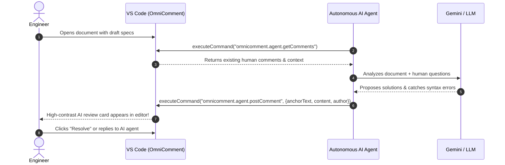

# OmniComment Hands-on Tutorial: From Zero to Hero

Welcome to the **OmniComment** hands-on tutorial. This guide walks you through every layer of OmniComment, from writing your first inline comment in VS Code to embedding interactive annotations in a web documentation site and building an autonomous AI review agent.

---

## Table of Contents

1. [Part 1: The VS Code Experience](#part-1-the-vs-code-experience)
2. [Part 2: Managing Configuration Presets](#part-2-managing-configuration-presets)
3. [Part 3: Embedding on Web Documentation Sites](#part-3-embedding-on-web-documentation-sites)
4. [Part 4: Web Browser Annotations (Chrome Extension)](#part-4-web-browser-annotations-chrome-extension)
5. [Part 5: Terminal & Neovim TUI Workflow](#part-5-terminal--neovim-tui-workflow)
6. [Part 6: Building an Autonomous AI Review Agent](#part-6-building-an-autonomous-ai-review-agent)

---

## Part 1: The VS Code Experience

### 1.1 Installation
1. Package or download the latest VSIX package:
   ```bash
   npx @vscode/vsce package --no-dependencies -o omnicomment-0.1.0.vsix
   ```
2. In VS Code, open the Extensions view (`Ctrl+Shift+X` or `Cmd+Shift+X`), click the **`...`** (Views and More Actions) menu at the top-right, and select **Install from VSIX...**.
3. Choose `omnicomment-0.1.0.vsix`.

### 1.2 Creating Your First Inline Comment
1. Open any Markdown file (e.g., `README.md` or `design.md`).
2. Highlight a phrase or sentence you want to discuss.
   > [!NOTE]
   > If you do not select any text, OmniComment automatically selects the word under your cursor or the full line.
3. Press **`Cmd+Shift+M`** (macOS) or **`Ctrl+Shift+M`** (Windows/Linux), or right-click and choose **OmniComment: Add Comment**.
4. An inline card will open immediately below the text. Type your comment and press **Enter** (or click **Comment**).

```markdown
# Architecture Overview

The system uses a distributed event bus for pub/sub communication.
<!-- omnicomment
{
  "version": 2,
  "comments": [
    {
      "id": "c-9182f",
      "anchor": {
        "text": "distributed event bus",
        "startLine": 2,
        "startChar": 19,
        "endLine": 2,
        "endChar": 40
      },
      "content": "Should we clarify if this supports Kafka or NATS?",
      "author": "Alice",
      "createdAt": "2026-10-28T14:00:00.000Z"
    }
  ]
}
-->
```

### 1.3 Replying to a Thread
1. Click the highlighted phrase in your editor. The inline thread card will reveal all previous comments and the reply box.
2. Type your response in the reply input field and click **Respond**.
3. The reply is appended directly to the comment's thread with your author name and timestamp.

### 1.4 Resolving and Collapsing Threads
- **Resolve / Reopen**: Click the **Checkmark** (`✓`) icon on any thread card to mark it as resolved.
  - Resolved comments hide their bright highlight in the document to reduce visual noise while keeping the thread accessible.
- **Collapse All / Expand All**: Click the **Collapse All** button in the editor title bar (`omnicomment.toggleCollapseAllComments`).
  - When collapsed, comment cards shrink to zero height, returning the editor to a clean reading view.

---

## Part 2: Managing Configuration Presets

OmniComment includes 5 built-in profiles designed for different modes of work:

| Preset Name | Ideal Workflow | Storage Engine | UI Footprint |
| :--- | :--- | :--- | :--- |
| `default` | General document editing | In-File (`<!-- omnicomment`) | Standard inline chips |
| `documentation-site` | Public docs, blogs, manuals | Local / Session storage | Minimal, non-distracting reading |
| `git-file-review` | Pull request and diff audits | In-File with Git history | Strict line tracking |
| `browser-annotator` | Web research & Chrome extension | Browser IndexedDB / Cloud | High-contrast highlights |
| `team-collaboration` | Multi-author engineering teams | REST API / Git synced | Full avatars & reaction tallies |
| `ai-agent-reviewer` | Automated LLM review loops | In-File with JSON export | Agent badges & bot hooks |

### 2.1 Switching Presets Interactively
1. Press `Cmd+Shift+P` (or `Ctrl+Shift+P`) to open the Command Palette.
2. Run: `OmniComment: Apply Preset Configuration...` (`omnicomment.applyPreset`).
3. Select your desired profile (e.g., `ai-agent-reviewer`).
4. OmniComment updates your settings and tunes highlight colors and storage behavior instantly.

### 2.2 Setting Presets in `settings.json`
You can declare workspace-wide presets in `.vscode/settings.json`:

```json
{
  "omnicomment.preset": "ai-agent-reviewer",
  "omnicomment.highlightColor": "rgba(99, 102, 241, 0.35)",
  "omnicomment.highlightBorderColor": "rgba(99, 102, 241, 0.85)"
}
```

---

## Part 3: Embedding on Web Documentation Sites

You can bring OmniComment's commenting system directly into your static documentation website or blog using the standalone `<omni-comment>` custom web component.

### 3.1 Basic HTML Integration
Place the script and custom tag into any HTML document:

```html
<!DOCTYPE html>
<html lang="en">
<head>
  <meta charset="UTF-8">
  <title>API Documentation</title>
</head>
<body>
  <main id="doc-content">
    <h1>Authentication API</h1>
    <p>All requests must include a Bearer token in the Authorization header.</p>
  </main>

  <!-- 1. Load the OmniComment Web Component -->
  <script type="module" src="https://unpkg.com/@omnicomment/web-plugin/dist/index.js"></script>

  <!-- 2. Attach OmniComment to your documentation container -->
  <omni-comment
    target="#doc-content"
    preset="documentation-site"
    author="Reader">
  </omni-comment>
</body>
</html>
```

### 3.2 Framework Integrations

#### Docusaurus Integration
Create a wrapper in `src/components/DocComments.tsx`:

```tsx
import React, { useEffect } from 'react';

export default function DocComments(): JSX.Element {
  useEffect(() => {
    import('@omnicomment/web-plugin');
  }, []);

  return (
    <div style={{ marginTop: '2rem' }}>
      <omni-comment
        target=".theme-doc-markdown"
        preset="documentation-site"
        storage="local">
      </omni-comment>
    </div>
  );
}
```

#### VitePress Integration
In `.vitepress/theme/Layout.vue`:

```vue
<template>
  <Layout>
    <template #doc-after>
      <omni-comment target=".vp-doc" preset="documentation-site" />
    </template>
  </Layout>
</template>

<script setup>
import DefaultTheme from 'vitepress/theme';
import { onMounted } from 'vue';

const { Layout } = DefaultTheme;

onMounted(async () => {
  await import('@omnicomment/web-plugin');
});
</script>
```

---

## Part 4: Web Browser Annotations (Chrome Extension)

OmniComment provides a Manifest V3 Chrome Extension allowing users to annotate any live website, blog, or internal intranet tool.

### 4.1 Loading the Extension
1. Open Google Chrome and navigate to `chrome://extensions/`.
2. Toggle **Developer mode** (top-right corner).
3. Click **Load unpacked** and select the extension directory (`packages/chrome-extension` or built distribution).

### 4.2 Annotating Web Pages
1. Visit any webpage (e.g., `https://developer.mozilla.org/`).
2. Highlight any text paragraph on the page.
3. Click the floating **OmniComment Chip** that appears near your cursor.
4. Enter your note or comment.
5. Notes persist across page reloads in Chrome's `chrome.storage.local` indexed by URL.

---

## Part 5: Terminal & Neovim TUI Workflow

OmniComment includes a standalone TUI renderer (`src/cli/tuiRenderer.ts`) that prints comment threads as ANSI cards with box-drawing characters for terminal users.

### 5.1 CLI Comment Inspection
Run the CLI tool against any Markdown file containing comments:

```bash
# Print all comments as ANSI cards
npx ts-node src/cli/tuiRenderer.ts docs/ARCHITECTURE.md

# Filter for only unresolved comments
npx ts-node src/cli/tuiRenderer.ts docs/ARCHITECTURE.md --unresolved
```

**Example Terminal Output:**
```text
┌─ [c-1049a] ──────────────────────────────────────────────────────────┐
│ Target: "3-Tier Fuzzy Anchoring" (Line 42)                          │
│ Author: Jordan · 2026-10-28 14:10:00 · Status: OPEN                 │
├──────────────────────────────────────────────────────────────────────┤
│ Content:                                                             │
│   Should we benchmark trigram matching performance on >1MB files?   │
│                                                                      │
│ Replies (1):                                                         │
│   ↳ Alex (2026-10-28 14:15:22):                                     │
│     Benchmarked in PR #12: Trigram takes < 1.2ms for 2MB buffers.     │
└──────────────────────────────────────────────────────────────────────┘
```

### 5.2 Neovim Quickfix Integration
You can pipe OmniComment's CLI output into Neovim's quickfix list:

```vim
" In your init.lua / init.vim
command! -nargs=0 OmniCommentLoad lua require('omnicomment').load_quickfix()
```

---

## Part 6: Building an Autonomous AI Review Agent

One of OmniComment's most powerful capabilities is its programmatic **Agent API** (`omnicomment.agent.*`). This lets AI agents participate in code and documentation reviews as equal collaborators.



### 6.1 Writing the Review Script
Here is an automated review script (`reviewAgent.ts`) using VS Code commands:

```typescript
import * as vscode from 'vscode';

export async function runAutomatedDocReview(docUri: vscode.Uri) {
  // 1. Fetch document and existing comments
  const doc = await vscode.workspace.openTextDocument(docUri);
  const text = doc.getText();

  const existingComments = await vscode.commands.executeCommand(
    'omnicomment.agent.getComments',
    { uri: docUri, includeResolved: false }
  );

  console.log(`Document has ${existingComments.length} active comment(s).`);

  // 2. Rule: Check for broken internal links
  const brokenLinkRegex = /\[([^\]]+)\]\(([^)]+)\)/g;
  let match: RegExpExecArray | null;

  while ((match = brokenLinkRegex.exec(text)) !== null) {
    const linkTarget = match[2];
    if (linkTarget.startsWith('#') || linkTarget.startsWith('http')) {
      continue;
    }

    // Verify if relative file target exists
    const targetUri = vscode.Uri.joinPath(vscode.Uri.file(doc.fileName), '..', linkTarget);
    try {
      await vscode.workspace.fs.stat(targetUri);
    } catch {
      // 3. Post an automated review comment directly at the broken link!
      await vscode.commands.executeCommand('omnicomment.agent.postComment', {
        uri: docUri,
        anchorText: match[0],
        content: `🚨 **AI Reviewer Warning**: Target file \`${linkTarget}\` does not exist on disk. Please verify this path.`,
        author: 'DocBot [AI]'
      });
      console.log(`Posted warning for broken link: ${linkTarget}`);
    }
  }

  // 4. Auto-reply to any human asking for help
  for (const comment of existingComments as any[]) {
    if (comment.content.toLowerCase().includes('@docbot summarize')) {
      await vscode.commands.executeCommand('omnicomment.agent.replyComment', {
        uri: docUri,
        commentId: comment.id,
        content: '🤖 Here is the section summary: This section specifies authentication requirements and token exchange flows.',
        author: 'DocBot [AI]'
      });
    }
  }
}
```

### 6.2 Congratulations!
You now have a complete end-to-end understanding of OmniComment:
- Creating and resolving inline discussions in VS Code.
- Tailoring behavior with 5 configuration presets.
- Embedding interactive comments in web documentation sites with `<omni-comment>`.
- Annotating arbitrary web pages with the Chrome extension.
- Inspecting comments in terminal TUI environments.
- Building autonomous AI agents that collaborate on documents.

---

## Where to Go From Here: Dedicated Surface Guides

To build deeper production integrations on specific surfaces, explore our dedicated guides:

- 💻 **[Web Applications Integration Guide](WEBAPP_GUIDE.md)**: Production-ready setups for React, Next.js, Vue 3, Nuxt, Svelte 5, SvelteKit, Web Component lifecycle, real-time sync (Supabase, WebSockets), and offline IndexedDB caching.
- 🧩 **[Chrome Extension Deep Dive Guide](CHROME_EXTENSION_GUIDE.md)**: Manifest V3 extension architecture, live DOM annotation with W3C `TextQuoteSelector`, Shadow DOM CSS style isolation, cross-device sync, and local VS Code bridge.
- 📟 **[Terminal & TUI Apps Guide](TUI_APPS_GUIDE.md)**: Headless CLI commands (`omnicomment-cli`), Neovim Lua plugin using `virt_lines` extmarks, Python Textual app, Go Bubbletea UI, and automated Git pre-commit hooks.
- 📝 **[VS Code Editor Modes Guide](VSCODE_MODES_GUIDE.md)**: Deep dive into all VS Code editor surfaces: Standard TextEditor, Vditor WYSIWYG Custom Editor, Jupyter Notebooks (`.ipynb`), Git split/unified diff reviews, and split-pane synchronization.
- 📚 **[Comprehensive API Reference](API_REFERENCE.md)**: Complete formal data model specifications, methods, and command definitions.
