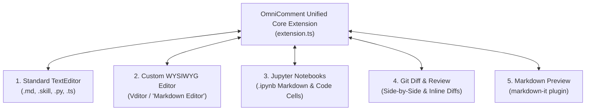
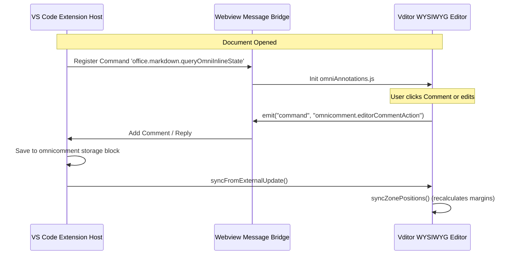

# OmniComment VS Code Editor Modes Guide

A detailed guide on utilizing **OmniComment** across all editor surfaces, custom editors, notebooks, diff viewers, and language modes in Visual Studio Code.

---

## Table of Contents

1. [Supported VS Code Editor Surfaces](#1-supported-vs-code-editor-surfaces)
2. [Standard TextEditor Mode (Markdown &amp; Code)](#2-standard-texteditor-mode)
   - [Enabling Programming Languages (`python`, `typescript`, etc.)](#enabling-programming-languages)
   - [Cursor &amp; Decoration Architecture](#cursor--decoration-architecture)
3. [Custom WYSIWYG Editors (&#34;Markdown Editor&#34; / Vditor)](#3-custom-wysiwyg-editors)
   - [Bidirectional Bridge Architecture](#bidirectional-bridge-architecture)
   - [Dynamic Vertical Margin Reservation](#dynamic-vertical-margin-reservation)
   - [In-Situ Zone Events &amp; Position Sync](#in-situ-zone-events--position-sync)
4. [Jupyter Notebooks (`.ipynb`)](#4-jupyter-notebooks)
5. [Git Diff &amp; SCM Review Mode (Split &amp; Unified)](#5-git-diff--scm-review-mode)
6. [Split Panes &amp; Multi-Window Synchronization](#6-split-panes--multi-window-synchronization)
7. [Comprehensive Keyboard Shortcuts &amp; Commands](#7-comprehensive-keyboard-shortcuts--commands)

---

## 1. Supported VS Code Editor Surfaces

OmniComment is engineered to operate seamlessly across **every** editing environment provided by the VS Code platform:



---

## 2. Standard TextEditor Mode

The default mode used for plain `.md` files, `.skill` files, and source code documents.

### Enabling Programming Languages

By default, OmniComment is activated for `markdown` and `skill` languages. You can enable inline commenting for any other language supported by VS Code (e.g. Python, TypeScript, C++, Rust, YAML, JSON).

In your user or workspace `settings.json`:

```json
{
  "omnicomment.enabledLanguages": [
    "markdown",
    "skill",
    "typescript",
    "typescriptreact",
    "javascript",
    "javascriptreact",
    "python",
    "go",
    "rust",
    "cpp",
    "yaml",
    "json"
  ]
}
```

### Cursor & Decoration Architecture

- **Non-Destructive Highlighting**: Highlights are projected onto the editor using `vscode.window.createTextEditorDecorationType`. The underlying text remains completely unmodified.
- **Smart Text Selection**:
  - If you select text and press `Cmd+Shift+M` (or `Ctrl+Shift+M`), the selected range is commented.
  - If your cursor is on a word without selection, OmniComment automatically expands to that word.
  - If your cursor is on an empty line, OmniComment selects the entire line.
- **Gutter Indicators**: A `💬` comment icon appears in the editor line number gutter for every line containing an unresolved comment thread.
- **Hover Tooltips**: Hovering your mouse over any highlighted word reveals a rich hover markdown card displaying the author, timestamp, comment text, and reply counts.

---

## 3. Custom WYSIWYG Editors ("Markdown Editor" / Vditor)

When you open Markdown files using graphical WYSIWYG editors (such as the popular **Markdown Editor** extension `cweijan.vscode-office` powered by Vditor), OmniComment injects client assets to render inline comment zones directly beneath blocks.

### Bidirectional Bridge Architecture



### Dynamic Vertical Margin Reservation

In WYSIWYG mode, comments are positioned in an overlay layer (`.omni-inline-zones-layer`) above the content. To prevent the comment box from overlapping the following paragraph, OmniComment dynamically injects stylesheet rules:

```css
[data-omni-zone="omni-zone-0"] {
  margin-bottom: 142px !important;
}
```

When you collapse a comment thread via the chevron (`⌃`), the zone height drops to `0px` and the margin-bottom is removed, allowing text below to snap back smoothly!

### In-Situ Zone Events & Position Sync

- **ResizeObserver**: Automatically repositions all inline comment zones whenever the editor window is resized or panels are expanded.
- **Scroll Synchronization**: Zone positions are locked to the editor container's scroll offsets.
- **Auto-Focus**: Clicking any comment card in the sidebar immediately scrolls the WYSIWYG view to center on the target block.

---

## 4. Jupyter Notebooks (`.ipynb`)

OmniComment supports annotating both **Markdown Documentation Cells** and **Executable Code Cells** in Jupyter Notebooks:

```
┌─────────────────────────────────────────────────────────────┐
│ [Markdown Cell]                                             │
│ # Step 1: Data Preprocessing                                │
│ We normalize the training tensors to [-1, 1] range.         │
│   ┌─ 💬 @MLReviewer: Check for division by zero std dev ───┐│
│   └────────────────────────────────────────────────────────┘│
├─────────────────────────────────────────────────────────────┤
│ [Code Cell]                                                 │
│ def normalize(x):                                           │
│     return (x - x.mean()) / x.std()                         │
└─────────────────────────────────────────────────────────────┘
```

### Notebook Specifics:

- **Cell Metadata Anchoring**: Anchors record the notebook cell index (`cellIndex`) in addition to line offsets.
- **Cell Reordering Resilience**: If cells are moved up or down within the notebook, comments follow their respective cell content without loss of alignment.
- **Clean Execution Output**: Comments are stored in cell metadata or trailing HTML comments, ensuring that running `Execute All Cells` is never disrupted.

---

## 5. Git Diff & SCM Review Mode (Split & Unified)

OmniComment provides first-class support for code review within VS Code's diff viewers:

### Side-by-Side Diffing

- Comments can be added to either the **original (left)** or **modified (right)** buffer.
- When commenting on modified lines, the anchor is attached to the modified line number and tracked against the Git working-tree revision.

### GitHub Pull Requests Integration

When reviewing Pull Requests using the official `GitHub Pull Requests and Issues` extension:

- OmniComment displays alongside GitHub review threads.
- You can export all OmniComment threads into GitHub PR comments with a single command:
  ```
  OmniComment: Export All Comments to GitHub Review...
  ```

---

## 6. Split Panes & Multi-Window Synchronization

Developers often open the same document in split panes (e.g. Markdown source on the left, WYSIWYG or preview on the right):

```
┌──────────────────────────────┬──────────────────────────────┐
│ Left: TextEditor (Source)    │ Right: Vditor (WYSIWYG)      │
│ 1 # Architecture             │ # Architecture               │
│ 2 The controller embeds...   │ The controller embeds...     │
│                              │   ┌─ 💬 Inline Zone ────────┐│
│                              │   └─────────────────────────┘│
└──────────────────────────────┴──────────────────────────────┘
```

### Synchronization Invariants:

1. **Zero Lag**: When you add, edit, or resolve a comment in the left pane, the right pane updates its inline zones within 40ms via `syncFromExternalUpdate()`.
2. **Cursor Safety**: Background updates do not steal focus or alter cursor selection in the active editor.
3. **Storage Single Source of Truth**: The active document text buffer is the authoritative state; disk writebacks occur without race conditions.

---

## 7. Comprehensive Keyboard Shortcuts & Commands

### Default Keyboard Shortcuts

| Shortcut (macOS)     | Shortcut (Windows/Linux) | Action                            | Command ID                         |
| :------------------- | :----------------------- | :-------------------------------- | :--------------------------------- |
| `Cmd + Shift + M`  | `Ctrl + Shift + M`     | Add Comment to selection / line   | `omnicomment.addComment`         |
| `Alt + Down`       | `Alt + Down`           | Jump to Next Comment              | `omnicomment.nextComment`        |
| `Alt + Up`         | `Alt + Up`             | Jump to Previous Comment          | `omnicomment.previousComment`    |
| `Cmd + Option + R` | `Ctrl + Alt + R`       | Toggle Resolve on current comment | `omnicomment.toggleResolve`      |
| `Cmd + Shift + C`  | `Ctrl + Shift + C`     | Open Comment Sidebar              | `omnicomment.commentsView.focus` |

---

### Command Palette Actions (`Ctrl+Shift+P` / `Cmd+Shift+P`)

| Command Label                                  | Description                                                |
| :--------------------------------------------- | :--------------------------------------------------------- |
| `OmniComment: Add Comment`                   | Prompts for comment text and attaches to current selection |
| `OmniComment: Next Comment`                  | Navigates to the next inline comment in document order     |
| `OmniComment: Previous Comment`              | Navigates to previous inline comment                       |
| `OmniComment: Toggle Resolved`               | Toggles the resolved status of the comment under cursor    |
| `OmniComment: Delete Comment`                | Deletes the comment thread at cursor                       |
| `OmniComment: Apply Preset Configuration...` | Interactive selector for 6 built-in presets                |
| `OmniComment: Export Context for LLM`        | Generates structured Markdown context for AI agents        |
| `OmniComment: Refresh Annotations`           | Forces full re-scan and anchor re-alignment                |

<!-- omnicomment
{
  "version": 2,
  "comments": [
    {
      "id": "56c6fe62-fc4a-4361-a800-f55a79715ed5",
      "anchor": {
        "text": "Bidirectional Bridge Architecture",
        "startLine": 13,
        "startChar": 6,
        "endLine": 13,
        "endChar": 39
      },
      "content": "This mermaid diagram could not be rendered in browser, showing \"Syntax error in text mermaid version 10.9.8\", please fix it",
      "author": "Hui Peng",
      "createdAt": "2026-10-29T07:03:22.535Z"
    }
  ]
}
-->
