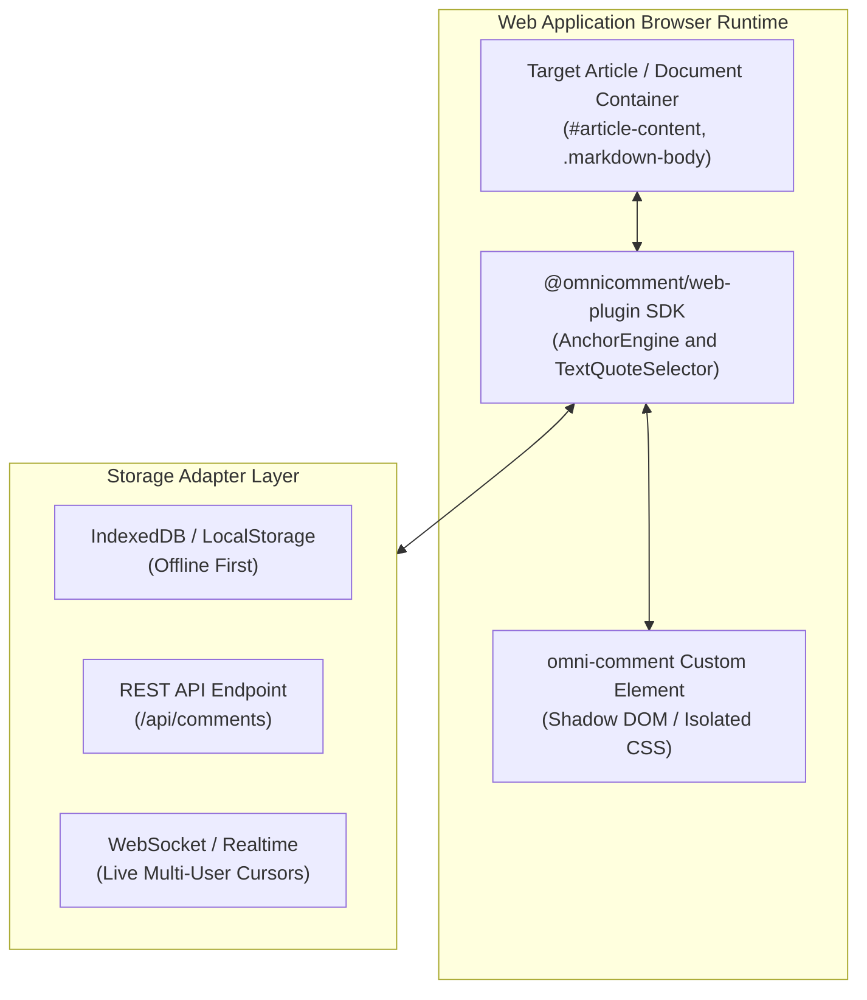

# OmniComment Web App Integration Guide

Comprehensive guide on embedding, customizing, and scaling **OmniComment** in modern web applications, documentation portals, Single Page Apps (SPA), and Content Management Systems (CMS).

---

## Table of Contents
1. [Overview & Architecture](#1-overview--architecture)
2. [Quickstart: Zero-Build Web Component](#2-quickstart-zero-build-web-component)
3. [React & Next.js Integration](#3-react--nextjs-integration)
4. [Vue 3 & Nuxt Integration](#4-vue-3--nuxt-integration)
5. [Svelte 5 & SvelteKit Integration](#5-svelte-5--sveltekit-integration)
6. [Angular 17 / 18 / 19 Integration](#6-angular-17--18--19-integration)
7. [Comment Persistence Approaches (With Full Code Samples)](#7-comment-persistence-approaches)
   - [Approach 1: REST API Storage (Client SDK & Next.js / Express Server)](#approach-1-rest-api-storage)
   - [Approach 2: Local-First Offline Storage (IndexedDB & LocalStorage)](#approach-2-local-first-offline-storage)
   - [Approach 3: Real-Time Collaborative Storage (Supabase & WebSockets)](#approach-3-real-time-collaborative-storage)
   - [Approach 4: Git-Compatible In-File Markdown Storage (CMS & Web Editors)](#approach-4-git-compatible-in-file-markdown-storage)
   - [Approach 5: Firebase Cloud Storage & Real-Time Sync (Firestore & Cloud Functions)](#approach-5-firebase-cloud-storage--real-time-sync)
8. [Authentication & Multi-Tenant User Roles](#8-authentication--multi-tenant-user-roles)
9. [Theming & CSS Custom Properties](#9-theming--css-custom-properties)
10. [Web SDK Programmatic API Reference](#10-web-sdk-programmatic-api-reference)

---

## 1. Overview & Architecture

The OmniComment Web SDK (`@omnicomment/web-plugin`) brings the exact same commenting, inline highlight, and thread resolution experience from VS Code directly into any browser application.



### Key Capabilities in Web Apps:
- **Zero Host Style Pollution**: Built inside an isolated Shadow DOM or clean BEM scope, preventing Tailwind, Bootstrap, or global CSS from distorting comment bubbles.
- **W3C Web Annotation Compliance**: Anchors use robust `TextQuoteSelector` (`exact`, `prefix`, `suffix`) that reliably re-anchor text even after CMS re-renders, layout reflows, or mobile responsive breakpoints.
- **Framework Agnostic**: Works natively with React, Vue, Svelte, Angular, Solid, or vanilla HTML.
- **Unified Data Format**: Comments are 100% interoperable with VS Code and Git Markdown files (`<!-- omnicomment ... -->`).

---

## 2. Quickstart: Zero-Build Web Component

For static sites (Hugo, Jekyll, 11ty, or raw HTML), embed the `<omni-comment>` custom web component with zero build tooling:

```html
<!DOCTYPE html>
<html lang="en">
<head>
  <meta charset="UTF-8">
  <title>Documentation Page</title>
  <!-- 1. Load OmniComment Stylesheet -->
  <link rel="stylesheet" href="https://unpkg.com/@omnicomment/web-plugin@0.1.0/dist/omnicomment.css">
</head>
<body>

  <!-- Your Main Content -->
  <main id="doc-content">
    <h1>API Overview</h1>
    <p>OmniComment enables universal commenting across all developer platforms.</p>
  </main>

  <!-- 2. Mount OmniComment Web Component -->
  <omni-comment
    target="#doc-content"
    preset="documentation-site"
    storage="local"
    allow-anonymous="true"
  ></omni-comment>

  <!-- 3. Load OmniComment JavaScript Module -->
  <script type="module" src="https://unpkg.com/@omnicomment/web-plugin@0.1.0/dist/index.js"></script>
</body>
</html>
```

### Supported Web Component Attributes:
| Attribute | Type | Default | Description |
| :--- | :--- | :--- | :--- |
| `target` | `string` | `"body"` | CSS selector of the container element whose text can be annotated. |
| `preset` | `string` | `"documentation-site"` | Built-in configuration profile (`documentation-site`, `team-collaboration`, etc.). |
| `storage` | `string` | `"local"` | Storage engine: `"local"`, `"indexeddb"`, or HTTP endpoint URL. |
| `document-id` | `string` | `window.location.pathname` | Unique document identifier used to partition comments. |
| `author` | `string` | `"Guest"` | Default author name for new comments. |
| `theme` | `string` | `"auto"` | `"dark"`, `"light"`, or `"auto"` (follows OS system preference). |

---

## 3. React & Next.js Integration

### Installation
```bash
npm install --save @omnicomment/web-plugin
```

### React Component (`OmniCommentContainer.tsx`)
```tsx
import React, { useEffect, useRef } from 'react';
import { initOmniComment, OmniCommentInstance } from '@omnicomment/web-plugin';
import '@omnicomment/web-plugin/dist/omnicomment.css';

interface OmniCommentProps {
  targetSelector: string;
  documentId: string;
  currentUser?: {
    id: string;
    name: string;
    avatar?: string;
  };
  onCommentCreated?: (comment: any) => void;
}

export const OmniCommentContainer: React.FC<OmniCommentProps> = ({
  targetSelector,
  documentId,
  currentUser,
  onCommentCreated
}) => {
  const instanceRef = useRef<OmniCommentInstance | null>(null);

  useEffect(() => {
    // Initialize OmniComment on mount
    instanceRef.current = initOmniComment({
      target: targetSelector,
      documentId: documentId,
      preset: 'team-collaboration',
      author: currentUser?.name || 'Anonymous User',
      authorAvatar: currentUser?.avatar,
      storage: {
        type: 'rest',
        endpoint: `/api/documents/${encodeURIComponent(documentId)}/comments`
      },
      onCommentAdded: (comment) => {
        onCommentCreated?.(comment);
      }
    });

    return () => {
      // Clean up highlights and event listeners on unmount
      instanceRef.current?.destroy();
      instanceRef.current = null;
    };
  }, [targetSelector, documentId, currentUser?.name]);

  return null; // OmniComment renders floating chips and overlays into portals
};
```

### Next.js App Router Usage (`app/docs/[slug]/page.tsx`)
```tsx
'use client';

import { OmniCommentContainer } from '@/components/OmniCommentContainer';

export default function DocPage({ params }: { params: { slug: string } }) {
  return (
    <article className="prose max-w-4xl mx-auto py-8">
      <div id="markdown-article">
        <h1>Architecture Specification</h1>
        <p>This paragraph can be highlighted and commented on in real time.</p>
      </div>

      <OmniCommentContainer
        targetSelector="#markdown-article"
        documentId={`doc-${params.slug}`}
        currentUser={{
          id: 'usr_123',
          name: 'Hui Peng',
          avatar: 'https://github.com/phui.png'
        }}
      />
    </article>
  );
}
```

---

## 4. Vue 3 & Nuxt Integration

### Vue 3 Composition API Component (`OmniComment.vue`)
```vue
<script setup lang="ts">
import { onMounted, onBeforeUnmount, ref } from 'vue';
import { initOmniComment, type OmniCommentInstance } from '@omnicomment/web-plugin';
import '@omnicomment/web-plugin/dist/omnicomment.css';

const props = withDefaults(
  defineProps<{
    target: string;
    docId: string;
    userName?: string;
  }>(),
  {
    userName: 'Anonymous'
  }
);

const emit = defineEmits(['commentAdded', 'commentResolved']);
let omniInstance: OmniCommentInstance | null = null;

onMounted(() => {
  omniInstance = initOmniComment({
    target: props.target,
    documentId: props.docId,
    author: props.userName,
    preset: 'documentation-site',
    storage: 'local',
    onCommentAdded: (c) => emit('commentAdded', c),
    onCommentResolved: (id) => emit('commentResolved', id)
  });
});

onBeforeUnmount(() => {
  omniInstance?.destroy();
});
</script>

<template>
  <div class="omnicomment-portal-mount" />
</template>
```

---

## 5. Svelte 5 & SvelteKit Integration

### Svelte Component (`OmniComment.svelte`)
```svelte
<script lang="ts">
  import { onMount, onDestroy } from 'svelte';
  import { initOmniComment, type OmniCommentInstance } from '@omnicomment/web-plugin';
  import '@omnicomment/web-plugin/dist/omnicomment.css';

  interface Props {
    target: string;
    docId: string;
    author?: string;
  }

  let { target, docId, author = 'Guest' }: Props = $props();
  let instance: OmniCommentInstance | null = null;

  onMount(() => {
    instance = initOmniComment({
      target,
      documentId: docId,
      author,
      preset: 'team-collaboration',
      storage: 'indexeddb'
    });
  });

  onDestroy(() => {
    instance?.destroy();
  });
</script>
```

---

## 6. Angular 17 / 18 / 19 Integration

### Installation
```bash
npm install --save @omnicomment/web-plugin
```

### Standalone Angular Component (`omni-comment.component.ts`)
```typescript
import { Component, Input, Output, EventEmitter, OnInit, OnDestroy } from '@angular/core';

@Component({
  selector: 'omni-comment',
  standalone: true,
  template: `<div class="omnicomment-angular-mount"></div>`,
  styles: [`:host { display: block; position: relative; }`]
})
export class OmniCommentComponent implements OnInit, OnDestroy {
  @Input({ required: true }) target!: string;
  @Input({ required: true }) documentId!: string;
  @Input() author: string = 'Anonymous';
  @Input() apiEndpoint?: string;
  @Input() preset: string = 'documentation-site';

  @Output() commentAdded = new EventEmitter<any>();
  @Output() commentResolved = new EventEmitter<string>();

  private omniInstance: any = null;

  ngOnInit(): void {
    // SSR guard: Ensure initialization runs strictly in browser runtime
    if (typeof window === 'undefined') return;

    import('@omnicomment/web-plugin').then(({ initOmniComment }) => {
      this.omniInstance = initOmniComment({
        target: this.target,
        documentId: this.documentId,
        author: this.author,
        preset: this.preset as any,
        storage: {
          type: 'rest',
          endpoint: this.apiEndpoint || `/api/documents/${encodeURIComponent(this.documentId)}/comments`
        },
        onCommentAdded: (c: any) => this.commentAdded.emit(c),
        onCommentResolved: (id: string) => this.commentResolved.emit(id)
      });
    });
  }

  ngOnDestroy(): void {
    this.omniInstance?.destroy();
  }
}
```

> [!TIP]
> OmniComment provides a complete, runnable **Angular SSR application server** hosting both Angular SSR views and the comment persistence REST API in [`servers/angular-ssr/`](../servers/angular-ssr/). See the [Server Frameworks Guide](docs/SERVER_FRAMEWORKS_GUIDE.md) for full architecture and RxJS service integration details.

---

## 7. Comment Persistence Approaches (With Full Code Samples)

OmniComment provides flexible storage adapters to support everything from offline-only personal wikis to large-scale enterprise team collaboration. Below are production-ready code samples for each of the four persistence approaches:

---

### Approach 1: REST API Storage (Client SDK & Next.js / Express Server)

Best suited for multi-user SaaS applications, internal documentation portals, and content management systems.

#### 1. Client-Side SDK Setup
```typescript
import { initOmniComment } from '@omnicomment/web-plugin';

const omni = initOmniComment({
  target: '#article-content',
  documentId: 'doc-guides-architecture',
  author: 'Sarah Connor',
  preset: 'team-collaboration',
  storage: {
    type: 'rest',
    endpoint: '/api/documents/doc-guides-architecture/comments',
    headers: {
      'Authorization': 'Bearer ' + userSessionToken,
      'Content-Type': 'application/json'
    }
  },
  onCommentAdded: (comment) => console.log('Comment created:', comment.id),
  onCommentResolved: (id) => console.log('Thread resolved:', id)
});
```

#### 2. Next.js App Router Route Handler (`app/api/documents/[docId]/comments/route.ts`)
```typescript
import { NextRequest, NextResponse } from 'next/server';

// In production, connect to Prisma / PostgreSQL / MongoDB
const db = new Map<string, any[]>();

// GET: Retrieve all comments for the specified document
export async function GET(
  request: NextRequest,
  { params }: { params: { docId: string } }
) {
  const docComments = db.get(params.docId) || [];
  return NextResponse.json({ comments: docComments });
}

// POST: Add a new comment thread
export async function POST(
  request: NextRequest,
  { params }: { params: { docId: string } }
) {
  const newComment = await request.json();
  const docComments = db.get(params.docId) || [];
  docComments.push(newComment);
  db.set(params.docId, docComments);
  return NextResponse.json({ success: true, comment: newComment }, { status: 201 });
}

// PATCH: Add reply, toggle resolved state, or edit content
export async function PATCH(
  request: NextRequest,
  { params }: { params: { docId: string } }
) {
  const { commentId, patch } = await request.json();
  const docComments = db.get(params.docId) || [];
  const target = docComments.find((c: any) => c.id === commentId);

  if (!target) {
    return NextResponse.json({ error: 'Comment not found' }, { status: 404 });
  }

  // Handle replies or top-level updates
  if (patch.reply) {
    target.replies = target.replies || [];
    target.replies.push(patch.reply);
  } else {
    Object.assign(target, patch);
  }
  target.updatedAt = new Date().toISOString();

  return NextResponse.json({ success: true, comment: target });
}

// DELETE: Delete a comment thread by ID
export async function DELETE(
  request: NextRequest,
  { params }: { params: { docId: string } }
) {
  const { searchParams } = new URL(request.url);
  const commentId = searchParams.get('id');
  let docComments = db.get(params.docId) || [];
  docComments = docComments.filter((c: any) => c.id !== commentId);
  db.set(params.docId, docComments);
  return NextResponse.json({ success: true });
}
```

> [!TIP]
> **Looking for backend servers in Python, Go, PHP, or Java?**
> OmniComment provides production-ready, standalone backend implementations in [`servers/python-fastapi/`](../servers/python-fastapi/), [`servers/go-gin/`](../servers/go-gin/), and [`servers/php/`](../servers/php/). For architecture details, database schemas, and framework-specific deployment instructions, see the dedicated [Server Frameworks Guide](docs/SERVER_FRAMEWORKS_GUIDE.md).


---

### Approach 2: Local-First Offline Storage (IndexedDB & LocalStorage)

Ideal for static site generators (Docusaurus, VitePress, Hugo), personal notes, and offline PWAs.

#### 1. Zero-Build Web Component Setup
```html
<!-- IndexedDB local persistence -->
<omni-comment
  target="#content-area"
  document-id="/docs/getting-started"
  storage="indexeddb"
  preset="documentation-site"
></omni-comment>
<script type="module" src="https://unpkg.com/@omnicomment/web-plugin/dist/index.js"></script>
```

#### 2. Advanced Client Setup with Export & Backup Utilities
```typescript
import { initOmniComment, OmniCommentInstance } from '@omnicomment/web-plugin';

// Initialize with IndexedDB adapter
const omni: OmniCommentInstance = initOmniComment({
  target: '#article-content',
  documentId: window.location.pathname,
  preset: 'documentation-site',
  storage: {
    type: 'indexeddb',
    dbName: 'omnicomment_offline_db',
    storeName: 'annotations'
  }
});

// Utility: Export all local comments as JSON for user backup
export async function exportLocalAnnotations(docId: string): Promise<string> {
  const allComments = omni.getComments();
  return JSON.stringify({ documentId: docId, exportedAt: new Date().toISOString(), comments: allComments }, null, 2);
}

// Utility: Clear all local comments for this page
export async function clearLocalAnnotations(): Promise<void> {
  const allComments = omni.getComments();
  for (const c of allComments) {
    omni.deleteComment(c.id);
  }
}
```

---

### Approach 3: Real-Time Collaborative Storage (Supabase & WebSockets)

Synchronizes comments, replies, and resolved states instantaneously across browser tabs, multiple remote users, and connected VS Code workspaces.

#### 3A. Supabase Realtime & PostgreSQL

##### PostgreSQL Table DDL:
```sql
CREATE TABLE public.omni_comments (
  id UUID PRIMARY KEY DEFAULT gen_random_uuid(),
  document_id TEXT NOT NULL,
  data JSONB NOT NULL,
  created_at TIMESTAMPTZ DEFAULT now(),
  updated_at TIMESTAMPTZ DEFAULT now()
);

-- Index by document ID for sub-millisecond retrieval
CREATE INDEX idx_omni_comments_doc ON public.omni_comments(document_id);

-- Enable Supabase Realtime replication on this table
ALTER PUBLICATION supabase_realtime ADD TABLE public.omni_comments;
```

##### Client Implementation:
```typescript
import { createClient } from '@supabase/supabase-js';
import { initOmniComment } from '@omnicomment/web-plugin';

const supabase = createClient('https://your-project.supabase.co', 'your-anon-key');

const docId = 'rfcs/proposal-42';

const omni = initOmniComment({
  target: '#rfc-body',
  documentId: docId,
  author: 'Jane Doe',
  storage: {
    type: 'custom',
    async loadComments(docId) {
      const { data } = await supabase
        .from('omni_comments')
        .select('data')
        .eq('document_id', docId);
      return data?.map(row => row.data) || [];
    },
    async saveComment(docId, comment) {
      await supabase.from('omni_comments').upsert({
        id: comment.id,
        document_id: docId,
        data: comment,
        updated_at: new Date().toISOString()
      });
    },
    async deleteComment(docId, commentId) {
      await supabase.from('omni_comments').delete().eq('id', commentId);
    }
  }
});

// Subscribe to real-time broadcasts from other team members
supabase
  .channel(`comments:${docId}`)
  .on('postgres_changes', { event: '*', schema: 'public', table: 'omni_comments', filter: `document_id=eq.${docId}` }, (payload) => {
    if (payload.eventType === 'INSERT' || payload.eventType === 'UPDATE') {
      omni.syncRemoteUpdate(payload.new.data);
    } else if (payload.eventType === 'DELETE') {
      omni.removeRemoteComment(payload.old.id);
    }
  })
  .subscribe();
```

#### 3B. Standalone WebSocket Broadcast Server (Node.js)

##### WebSocket Server (`server.js`):
```javascript
const WebSocket = require('ws');
const wss = new WebSocket.Server({ port: 8080 });

// Room-based broadcasting: room -> Set of WebSocket clients
const rooms = new Map();

wss.on('connection', (ws, req) => {
  const url = new URL(req.url, 'http://localhost:8080');
  const room = url.searchParams.get('room') || 'default';

  if (!rooms.has(room)) rooms.set(room, new Set());
  const clients = rooms.get(room);
  clients.add(ws);

  ws.on('message', (message) => {
    // Broadcast received comment event to all other clients in the same room
    for (const client of clients) {
      if (client !== ws && client.readyState === WebSocket.OPEN) {
        client.send(message);
      }
    }
  });

  ws.on('close', () => {
    clients.delete(ws);
    if (clients.size === 0) rooms.delete(room);
  });
});

console.log('OmniComment WebSocket sync server listening on ws://localhost:8080');
```

##### Client Implementation:
```typescript
import { initOmniComment } from '@omnicomment/web-plugin';

const docId = 'spec-markdown-editor';
const socket = new WebSocket(`ws://localhost:8080?room=${encodeURIComponent(docId)}`);

const omni = initOmniComment({
  target: '#article-container',
  documentId: docId,
  author: 'Hui Peng',
  storage: {
    type: 'custom',
    saveComment: (docId, comment) => {
      socket.send(JSON.stringify({ type: 'UPSERT_COMMENT', comment }));
    },
    deleteComment: (docId, commentId) => {
      socket.send(JSON.stringify({ type: 'DELETE_COMMENT', commentId }));
    }
  }
});

socket.onmessage = (event) => {
  const msg = JSON.parse(event.data);
  if (msg.type === 'UPSERT_COMMENT') {
    omni.syncRemoteUpdate(msg.comment);
  } else if (msg.type === 'DELETE_COMMENT') {
    omni.removeRemoteComment(msg.commentId);
  }
};
```

---

### Approach 4: Git-Compatible In-File Markdown Storage (CMS & Web Editors)

When building in-browser Markdown editors (using Monaco, CodeMirror, or Vditor) or publishing to GitHub via API, comments can be serialized directly into Markdown documents using the same `<!-- omnicomment` block structure as the VS Code extension.

#### Web Markdown Editor Integration Sample:
```typescript
import { MarkdownStorageAdapter } from '@omnicomment/core';
import { initOmniComment, OmniCommentInstance } from '@omnicomment/web-plugin';

export class MarkdownDocManager {
  private adapter = new MarkdownStorageAdapter();
  private omni: OmniCommentInstance | null = null;
  private currentMarkdown: string = '';

  constructor(private containerSelector: string) {}

  /**
   * Loads a raw Markdown document, extracts embedded comments, and attaches OmniComment UI
   */
  public loadDocument(rawMarkdown: string, docId: string): void {
    this.currentMarkdown = rawMarkdown;

    // 1. Extract existing comments from <!-- omnicomment block
    const existingComments = this.adapter.parseCommentsFromText(rawMarkdown);

    // 2. Initialize OmniComment with extracted comments
    this.omni = initOmniComment({
      target: this.containerSelector,
      documentId: docId,
      initialComments: existingComments,
      storage: {
        type: 'custom',
        saveComment: () => {
          this.syncMarkdownBuffer();
        },
        deleteComment: () => {
          this.syncMarkdownBuffer();
        }
      }
    });
  }

  /**
   * Re-serializes active comments into the Markdown buffer
   */
  private syncMarkdownBuffer(): void {
    if (!this.omni) return;
    const activeComments = this.omni.getComments();
    this.currentMarkdown = this.adapter.formatUpdatedText(this.currentMarkdown, activeComments);
  }

  /**
   * Returns complete Markdown text with updated <!-- omnicomment block ready to commit to Git
   */
  public getGitReadyMarkdown(): string {
    this.syncMarkdownBuffer();
    return this.currentMarkdown;
  }

  /**
   * Pushes updated Markdown directly to GitHub repository via GitHub REST API
   */
  public async pushToGitHub(repo: string, filePath: string, token: string, commitMsg: string): Promise<void> {
    const updatedContent = this.getGitReadyMarkdown();
    const base64Content = btoa(unescape(encodeURIComponent(updatedContent)));

    // 1. Get existing file SHA
    const fileRes = await fetch(`https://api.github.com/repos/${repo}/contents/${filePath}`, {
      headers: { Authorization: `token ${token}` }
    });
    const fileData = await fileRes.json();

    // 2. Commit update
    await fetch(`https://api.github.com/repos/${repo}/contents/${filePath}`, {
      method: 'PUT',
      headers: {
        Authorization: `token ${token}`,
        'Content-Type': 'application/json'
      },
      body: JSON.stringify({
        message: commitMsg,
        content: base64Content,
        sha: fileData.sha
      })
    });
  }
}
```

---

### Approach 5: Firebase Cloud Storage & Real-Time Sync (Firestore & Cloud Functions)

For high-concurrency cloud persistence with sub-100ms latency, seamless offline capabilities, and zero-maintenance infrastructure, OmniComment provides an official Firebase server backend (`servers/firebase/`) using **Firebase Cloud Functions (v2)** and **Google Cloud Firestore**.

#### 1. Real-Time Client Integration (`firebase/firestore`)
```typescript
import { initializeApp } from 'firebase/app';
import { getFirestore, collection, query, orderBy, onSnapshot, doc, setDoc, deleteDoc } from 'firebase/firestore';
import { initOmniComment } from '@omnicomment/web-plugin';

const app = initializeApp({
  apiKey: "AIzaSy...",
  projectId: "my-docs-app"
});
const db = getFirestore(app);

const omni = initOmniComment({
  target: '#article-container',
  documentId: 'api-reference-v2',
  author: 'Ada Lovelace',
  storage: {
    type: 'custom',
    subscribe: (docId, onUpdate) => {
      const q = query(collection(db, 'documents', docId, 'comments'), orderBy('createdAt', 'asc'));
      return onSnapshot(q, (snapshot) => onUpdate(snapshot.docs.map(d => d.data())));
    },
    saveComment: async (docId, comment) => {
      await setDoc(doc(db, 'documents', docId, 'comments', comment.id), comment, { merge: true });
    },
    deleteComment: async (docId, commentId) => {
      await deleteDoc(doc(db, 'documents', docId, 'comments', commentId));
    }
  }
});
```

> [!TIP]
> For the complete backend implementation, local emulator configuration, security rules, and production deployment instructions, see the dedicated [Firebase Server Guide](docs/FIREBASE_SERVER_GUIDE.md).

---

## 8. Authentication & Multi-Tenant User Roles

Control who can comment, edit, resolve, or delete threads:

```typescript
initOmniComment({
  target: '#content',
  currentUser: {
    id: 'user_481',
    name: 'Sarah Connor',
    role: 'moderator', // 'admin' | 'moderator' | 'member' | 'viewer'
    avatar: 'https://avatar.example.com/sarah.jpg'
  },
  permissions: {
    canComment: true,
    canReply: true,
    canResolveAny: true,      // Moderators can resolve anyone's comment
    canDeleteAny: false,      // Can only delete their own comments
    canThumbsUp: true
  }
});
```

---

## 9. Theming & CSS Custom Properties

OmniComment supports comprehensive theming via CSS variables. Override any of the following tokens in your application's CSS:

```css
:root {
  /* Highlight Colors */
  --omni-highlight-bg: rgba(255, 212, 0, 0.24);
  --omni-highlight-border: #e6a500;
  --omni-highlight-focused: rgba(255, 165, 0, 0.45);

  /* Card & Thread Styles */
  --omni-card-bg: #1e2227;
  --omni-card-border: #323842;
  --omni-card-shadow: 0 4px 16px rgba(0, 0, 0, 0.35);
  --omni-font-family: 'Inter', -apple-system, sans-serif;
  --omni-font-size: 13px;

  /* Accent & Action Colors */
  --omni-primary: #0078d4;
  --omni-primary-hover: #106ebe;
  --omni-resolved-color: #89d185;
  --omni-danger-color: #f48771;
}

/* Light Theme Overrides */
[data-theme="light"] {
  --omni-highlight-bg: rgba(255, 220, 40, 0.35);
  --omni-card-bg: #ffffff;
  --omni-card-border: #e1e4e8;
  --omni-card-shadow: 0 4px 14px rgba(0, 0, 0, 0.08);
}
```

---

## 10. Web SDK Programmatic API Reference

When initialized, `initOmniComment()` returns an `OmniCommentInstance` handle:

```typescript
const omni = initOmniComment({ target: '#article' });

// 1. Programmatically add a comment
omni.addComment({
  anchorText: 'universal commenting and annotation',
  content: 'Automated comment posted from client script',
  author: 'Bot'
});

// 2. Query all active comments
const threads = omni.getComments();
console.log(`Active thread count: ${threads.length}`);

// 3. Focus and scroll to a specific comment
omni.focusComment('comment-uuid-1234');

// 4. Toggle resolved state
omni.resolveComment('comment-uuid-1234', true);

// 5. Export comments in Git-compatible Markdown format
const mdBlock = omni.exportMarkdownBlock();
console.log(mdBlock); // <!-- omnicomment\n{...}\n-->

// 6. Destroy instance and unbind DOM listeners
omni.destroy();
```
