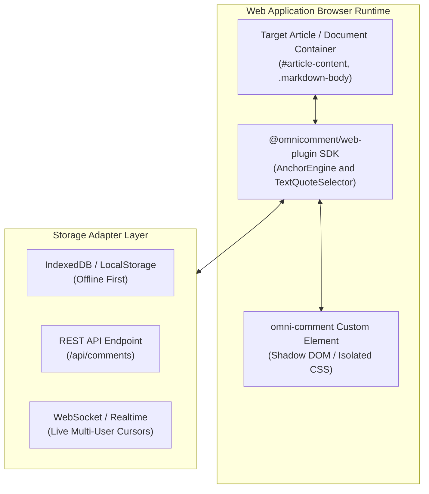

# OmniComment Web App Integration Guide

Comprehensive guide on embedding, customizing, and scaling **OmniComment** in modern web applications, documentation portals, Single Page Apps (SPA), and Content Management Systems (CMS).

---

## Table of Contents
1. [Overview & Architecture](#1-overview--architecture)
2. [Quickstart: Zero-Build Web Component](#2-quickstart-zero-build-web-component)
3. [React & Next.js Integration](#3-react--nextjs-integration)
4. [Vue 3 & Nuxt Integration](#4-vue-3--nuxt-integration)
5. [Svelte 5 & SvelteKit Integration](#5-svelte-5--sveltekit-integration)
6. [Real-Time Collaboration & Storage Backends](#6-real-time-collaboration--storage-backends)
   - [Local-First (IndexedDB / LocalStorage)](#local-first-storage)
   - [Supabase & PostgreSQL (Realtime Subscriptions)](#supabase--postgresql-realtime)
   - [WebSocket Broadcast Server (Node.js / Go)](#websocket-broadcast-server)
7. [Authentication & Multi-Tenant User Roles](#7-authentication--multi-tenant-user-roles)
8. [Theming & CSS Custom Properties](#8-theming--css-custom-properties)
9. [Web SDK Programmatic API Reference](#9-web-sdk-programmatic-api-reference)

---

## 1. Overview & Architecture

The OmniComment Web SDK (`@omnicomment/web-plugin`) brings the exact same commenting, inline highlight, and thread resolution experience from VS Code directly into any browser application.



### Key Capabilities in Web Apps:
- **Zero Host Style Pollution**: Built inside an isolated Shadow DOM or clean BEM scope, preventing Tailwind, Bootstrap, or global CSS from distorting comment bubbles.
- **W3C Web Annotation Compliance**: Anchors use robust `TextQuoteSelector` (`exact`, `prefix`, `suffix`) that reliably re-anchor text even after CMS re-renders, layout reflows, or mobile responsive breakpoints.
- **Framework Agnostic**: Works natively with React, Vue, Svelte, Angular, Solid, or vanilla HTML.
- **Unified Data Format**: Comments are 100% interoperable with VS Code and Git Markdown files (`<!-- omnicomment ... -->`).

---

## 2. Quickstart: Zero-Build Web Component

For static sites (Hugo, Jekyll, 11ty, or raw HTML), embed the `<omni-comment>` custom web component with zero build tooling:

```html
<!DOCTYPE html>
<html lang="en">
<head>
  <meta charset="UTF-8">
  <title>Documentation Page</title>
  <!-- 1. Load OmniComment Stylesheet -->
  <link rel="stylesheet" href="https://unpkg.com/@omnicomment/web-plugin@0.1.0/dist/omnicomment.css">
</head>
<body>

  <!-- Your Main Content -->
  <main id="doc-content">
    <h1>API Overview</h1>
    <p>OmniComment enables universal commenting across all developer platforms.</p>
  </main>

  <!-- 2. Mount OmniComment Web Component -->
  <omni-comment
    target="#doc-content"
    preset="documentation-site"
    storage="local"
    allow-anonymous="true"
  ></omni-comment>

  <!-- 3. Load OmniComment JavaScript Module -->
  <script type="module" src="https://unpkg.com/@omnicomment/web-plugin@0.1.0/dist/index.js"></script>
</body>
</html>
```

### Supported Web Component Attributes:
| Attribute | Type | Default | Description |
| :--- | :--- | :--- | :--- |
| `target` | `string` | `"body"` | CSS selector of the container element whose text can be annotated. |
| `preset` | `string` | `"documentation-site"` | Built-in configuration profile (`documentation-site`, `team-collaboration`, etc.). |
| `storage` | `string` | `"local"` | Storage engine: `"local"`, `"indexeddb"`, or HTTP endpoint URL. |
| `document-id` | `string` | `window.location.pathname` | Unique document identifier used to partition comments. |
| `author` | `string` | `"Guest"` | Default author name for new comments. |
| `theme` | `string` | `"auto"` | `"dark"`, `"light"`, or `"auto"` (follows OS system preference). |

---

## 3. React & Next.js Integration

### Installation
```bash
npm install --save @omnicomment/web-plugin
```

### React Component (`OmniCommentContainer.tsx`)
```tsx
import React, { useEffect, useRef } from 'react';
import { initOmniComment, OmniCommentInstance } from '@omnicomment/web-plugin';
import '@omnicomment/web-plugin/dist/omnicomment.css';

interface OmniCommentProps {
  targetSelector: string;
  documentId: string;
  currentUser?: {
    id: string;
    name: string;
    avatar?: string;
  };
  onCommentCreated?: (comment: any) => void;
}

export const OmniCommentContainer: React.FC<OmniCommentProps> = ({
  targetSelector,
  documentId,
  currentUser,
  onCommentCreated
}) => {
  const instanceRef = useRef<OmniCommentInstance | null>(null);

  useEffect(() => {
    // Initialize OmniComment on mount
    instanceRef.current = initOmniComment({
      target: targetSelector,
      documentId: documentId,
      preset: 'team-collaboration',
      author: currentUser?.name || 'Anonymous User',
      authorAvatar: currentUser?.avatar,
      storage: {
        type: 'rest',
        endpoint: `/api/documents/${encodeURIComponent(documentId)}/comments`
      },
      onCommentAdded: (comment) => {
        onCommentCreated?.(comment);
      }
    });

    return () => {
      // Clean up highlights and event listeners on unmount
      instanceRef.current?.destroy();
      instanceRef.current = null;
    };
  }, [targetSelector, documentId, currentUser?.name]);

  return null; // OmniComment renders floating chips and overlays into portals
};
```

### Next.js App Router Usage (`app/docs/[slug]/page.tsx`)
```tsx
'use client';

import { OmniCommentContainer } from '@/components/OmniCommentContainer';

export default function DocPage({ params }: { params: { slug: string } }) {
  return (
    <article className="prose max-w-4xl mx-auto py-8">
      <div id="markdown-article">
        <h1>Architecture Specification</h1>
        <p>This paragraph can be highlighted and commented on in real time.</p>
      </div>

      <OmniCommentContainer
        targetSelector="#markdown-article"
        documentId={`doc-${params.slug}`}
        currentUser={{
          id: 'usr_123',
          name: 'Hui Peng',
          avatar: 'https://github.com/phui.png'
        }}
      />
    </article>
  );
}
```

---

## 4. Vue 3 & Nuxt Integration

### Vue 3 Composition API Component (`OmniComment.vue`)
```vue
<script setup lang="ts">
import { onMounted, onBeforeUnmount, ref } from 'vue';
import { initOmniComment, type OmniCommentInstance } from '@omnicomment/web-plugin';
import '@omnicomment/web-plugin/dist/omnicomment.css';

const props = withDefaults(
  defineProps<{
    target: string;
    docId: string;
    userName?: string;
  }>(),
  {
    userName: 'Anonymous'
  }
);

const emit = defineEmits(['commentAdded', 'commentResolved']);
let omniInstance: OmniCommentInstance | null = null;

onMounted(() => {
  omniInstance = initOmniComment({
    target: props.target,
    documentId: props.docId,
    author: props.userName,
    preset: 'documentation-site',
    storage: 'local',
    onCommentAdded: (c) => emit('commentAdded', c),
    onCommentResolved: (id) => emit('commentResolved', id)
  });
});

onBeforeUnmount(() => {
  omniInstance?.destroy();
});
</script>

<template>
  <div class="omnicomment-portal-mount" />
</template>
```

---

## 5. Svelte 5 & SvelteKit Integration

### Svelte Component (`OmniComment.svelte`)
```svelte
<script lang="ts">
  import { onMount, onDestroy } from 'svelte';
  import { initOmniComment, type OmniCommentInstance } from '@omnicomment/web-plugin';
  import '@omnicomment/web-plugin/dist/omnicomment.css';

  interface Props {
    target: string;
    docId: string;
    author?: string;
  }

  let { target, docId, author = 'Guest' }: Props = $props();
  let instance: OmniCommentInstance | null = null;

  onMount(() => {
    instance = initOmniComment({
      target,
      documentId: docId,
      author,
      preset: 'team-collaboration',
      storage: 'indexeddb'
    });
  });

  onDestroy(() => {
    instance?.destroy();
  });
</script>
```

---

## 6. Real-Time Collaboration & Storage Backends

OmniComment provides flexible storage adapters to support everything from offline-only personal wikis to large-scale enterprise team collaboration.

### Local-First Storage
Ideal for offline PWAs, local tools, and blogs without backend authentication:
```typescript
import { initOmniComment } from '@omnicomment/web-plugin';

initOmniComment({
  target: '#article',
  storage: {
    type: 'indexeddb',
    dbName: 'my_app_annotations',
    storeName: 'comments'
  }
});
```

### Supabase & PostgreSQL (Realtime Subscriptions)
Synchronize comments between multiple web users and VS Code automatically using Supabase Realtime:

```typescript
import { createClient } from '@supabase/supabase-js';
import { initOmniComment } from '@omnicomment/web-plugin';

const supabase = createClient('https://xyzcompany.supabase.co', 'public-anon-key');

const omni = initOmniComment({
  target: '#article',
  documentId: 'rfc-102',
  storage: {
    type: 'custom',
    async loadComments(docId) {
      const { data } = await supabase
        .from('comments')
        .select('*')
        .eq('document_id', docId);
      return data || [];
    },
    async saveComment(docId, comment) {
      await supabase.from('comments').upsert({
        id: comment.id,
        document_id: docId,
        data: comment
      });
    },
    async deleteComment(docId, commentId) {
      await supabase.from('comments').delete().eq('id', commentId);
    }
  }
});

// Subscribe to live changes broadcast by team members
supabase
  .channel('public:comments')
  .on('postgres_changes', { event: '*', schema: 'public', table: 'comments' }, (payload) => {
    if (payload.new) {
      omni.syncRemoteUpdate(payload.new.data);
    }
  })
  .subscribe();
```

### WebSocket Broadcast Server
Connect browser users and VS Code instances on the same local network or team server:

```typescript
const socket = new WebSocket('wss://comments.internal.net/ws?room=doc-42');

const omni = initOmniComment({
  target: '#content',
  storage: {
    type: 'custom',
    saveComment: (docId, comment) => {
      socket.send(JSON.stringify({ type: 'ADD_COMMENT', comment }));
    }
  }
});

socket.onmessage = (event) => {
  const msg = JSON.parse(event.data);
  if (msg.type === 'SYNC') {
    omni.syncAllComments(msg.comments);
  }
};
```

---

## 7. Authentication & Multi-Tenant User Roles

Control who can comment, edit, resolve, or delete threads:

```typescript
initOmniComment({
  target: '#content',
  currentUser: {
    id: 'user_481',
    name: 'Sarah Connor',
    role: 'moderator', // 'admin' | 'moderator' | 'member' | 'viewer'
    avatar: 'https://avatar.example.com/sarah.jpg'
  },
  permissions: {
    canComment: true,
    canReply: true,
    canResolveAny: true,      // Moderators can resolve anyone's comment
    canDeleteAny: false,      // Can only delete their own comments
    canThumbsUp: true
  }
});
```

---

## 8. Theming & CSS Custom Properties

OmniComment supports comprehensive theming via CSS variables. Override any of the following tokens in your application's CSS:

```css
:root {
  /* Highlight Colors */
  --omni-highlight-bg: rgba(255, 212, 0, 0.24);
  --omni-highlight-border: #e6a500;
  --omni-highlight-focused: rgba(255, 165, 0, 0.45);

  /* Card & Thread Styles */
  --omni-card-bg: #1e2227;
  --omni-card-border: #323842;
  --omni-card-shadow: 0 4px 16px rgba(0, 0, 0, 0.35);
  --omni-font-family: 'Inter', -apple-system, sans-serif;
  --omni-font-size: 13px;

  /* Accent & Action Colors */
  --omni-primary: #0078d4;
  --omni-primary-hover: #106ebe;
  --omni-resolved-color: #89d185;
  --omni-danger-color: #f48771;
}

/* Light Theme Overrides */
[data-theme="light"] {
  --omni-highlight-bg: rgba(255, 220, 40, 0.35);
  --omni-card-bg: #ffffff;
  --omni-card-border: #e1e4e8;
  --omni-card-shadow: 0 4px 14px rgba(0, 0, 0, 0.08);
}
```

---

## 9. Web SDK Programmatic API Reference

When initialized, `initOmniComment()` returns an `OmniCommentInstance` handle:

```typescript
const omni = initOmniComment({ target: '#article' });

// 1. Programmatically add a comment
omni.addComment({
  anchorText: 'universal commenting and annotation',
  content: 'Automated comment posted from client script',
  author: 'Bot'
});

// 2. Query all active comments
const threads = omni.getComments();
console.log(`Active thread count: ${threads.length}`);

// 3. Focus and scroll to a specific comment
omni.focusComment('comment-uuid-1234');

// 4. Toggle resolved state
omni.resolveComment('comment-uuid-1234', true);

// 5. Export comments in Git-compatible Markdown format
const mdBlock = omni.exportMarkdownBlock();
console.log(mdBlock); // <!-- omnicomment\n{...}\n-->

// 6. Destroy instance and unbind DOM listeners
omni.destroy();
```
